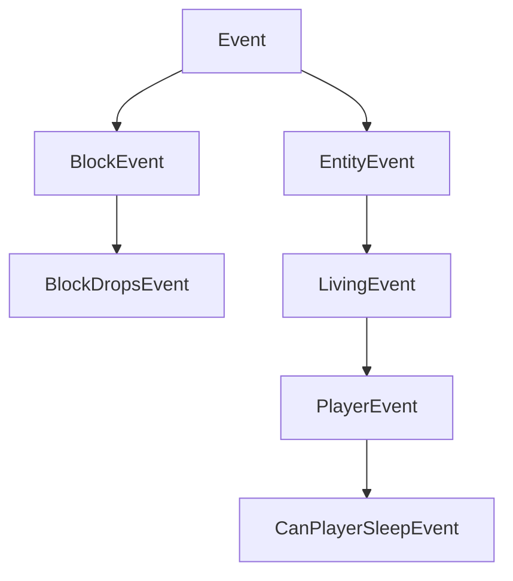

import Tabs from '@theme/Tabs';
import TabItem from '@theme/TabItem';

# 事件

NeoForge 的主要功能之一是事件系统。游戏中发生的各种事情都会触发事件，例如玩家右键单击、玩家或其他实体跳跃、方块渲染、游戏加载等。模组作者可以为这些事件订阅事件处理器，并在处理器中执行所需操作。

事件会在各自的事件总线上触发。最重要的是 `NeoForge.EVENT_BUS`，也称为**游戏**总线。此外，启动期间，每个已加载模组都会创建一条模组总线，并传入该模组的构造方法。许多模组总线事件会并行触发，而主总线事件始终在同一线程运行，这大大提高了启动速度。更多信息见[下文][modbus]。

## 注册事件处理器 {#registering-an-event-handler}

注册事件处理器有多种方式。所有方式的共同点是：每个事件处理器都是一个方法，只接收一个事件参数，并且没有返回值（即返回类型为 `void`）。

### `IEventBus#addListener`

注册方法处理器最简单的方式是传入方法引用：

```java
@Mod("yourmodid")
public class YourMod {
    public YourMod(IEventBus modBus) {
        NeoForge.EVENT_BUS.addListener(YourMod::onLivingJump);
    }

    // 实体每次跳跃时，为其恢复半颗心的生命值。
    private static void onLivingJump(LivingEvent.LivingJumpEvent event) {
        LivingEntity entity = event.getEntity();
        // 只在服务端恢复生命值
        if (!entity.level().isClientSide()) {
            entity.heal(1);
        }
    }
}
```

### `@SubscribeEvent`

也可以采用注解驱动的方式：创建事件处理方法，并为其添加 `@SubscribeEvent` 注解。然后把包含该方法的类实例传给事件总线，从而注册该实例中所有带 `@SubscribeEvent` 注解的事件处理器：

```java
public class EventHandler {
    @SubscribeEvent
    public void onLivingJump(LivingEvent.LivingJumpEvent event) {
        LivingEntity entity = event.getEntity();
        if (!entity.level().isClientSide()) {
            entity.heal(1);
        }
    }
}

@Mod("yourmodid")
public class YourMod {
    public YourMod(IEventBus modBus) {
        NeoForge.EVENT_BUS.register(new EventHandler());
    }
}
```

还可以使用静态方式：把所有事件处理器都声明为静态方法，并传入类本身，而不是类实例：

```java
public class EventHandler {
    @SubscribeEvent
    public static void onLivingJump(LivingEvent.LivingJumpEvent event) {
        LivingEntity entity = event.getEntity();
        if (!entity.level().isClientSide()) {
            entity.heal(1);
        }
    }
}

@Mod("yourmodid")
public class YourMod {
    public YourMod(IEventBus modBus) {
        NeoForge.EVENT_BUS.register(EventHandler.class);
    }
}
```

### `@EventBusSubscriber`

还可以更进一步，为事件处理器类添加 `@EventBusSubscriber` 注解。NeoForge 会自动发现该注解，因此可以删除模组构造方法中的所有事件相关代码。它本质上等同于在模组构造方法末尾调用 `NeoForge.EVENT_BUS.register(EventHandler.class)` 和 `modBus.register(EventHandler.class)`，这也意味着所有处理器都必须是静态方法。

虽然不是必需项，但强烈建议在注解中指定 `modid` 参数，以便调试，尤其是在处理模组冲突时。

```java
@EventBusSubscriber(modid = "yourmodid")
public class EventHandler {
    @SubscribeEvent
    public static void onLivingJump(LivingEvent.LivingJumpEvent event) {
        LivingEntity entity = event.getEntity();
        if (!entity.level().isClientSide()) {
            entity.heal(1);
        }
    }
}
```

## 事件的内容

### 字段和方法

字段和方法大概是事件中最直观的部分。大多数事件都包含供事件处理器使用的上下文，例如触发事件的实体或事件所在的世界。

### 继承关系

为了利用继承的优势，一些事件并不直接继承 `Event`，而是继承其某个子类，例如 `BlockEvent`（包含方块相关事件的上下文）或 `EntityEvent`（同样包含实体上下文），以及后者的子类 `LivingEvent`（用于 `LivingEntity` 的专属上下文）和 `PlayerEvent`（用于 `Player` 的专属上下文）。这些提供上下文的父事件都是 `abstract`，不能直接监听。

:::danger
监听 `abstract` 事件会导致游戏崩溃，因为这从来不是你想要的结果。你始终应监听其某个子事件。
:::



_<span class="mermaid-desc-yellow">黄色</span>类为 `abstract`，<span class="mermaid-desc-blue">蓝色</span>类不是 `abstract`。_

### 可取消事件 {#cancellable-events}

有些事件实现了 `ICancellableEvent` 接口。这类事件可通过 `#setCanceled(boolean canceled)` 取消，并可通过 `#isCanceled()` 检查取消状态。事件被取消后，该事件的其他事件处理器不会运行，同时会启用与“取消”相关的某种行为。例如，取消 `LivingChangeTargetEvent` 会阻止实体更改目标实体。

事件处理器可以显式接收已取消的事件。根据附加事件处理器的方式，可以在 `IEventBus#addListener` 或 `@SubscribeEvent` 中把 `receiveCanceled` 布尔参数设为 true。

### 三态和结果

有些事件有三种可能的返回状态，由 `TriState` 表示，或者直接使用事件类中定义的 `Result` 枚举。返回状态通常可以取消当前事件正在处理的操作（`TriState#FALSE`）、强制运行该操作（`TriState#TRUE`），或执行原版默认行为（`TriState#DEFAULT`）。

具有三种可能返回状态的事件会提供某个 `set*` 方法来设置所需结果。

```java
// 位于某个事件处理器类中

@SubscribeEvent // 在游戏事件总线上
public static void renderNameTag(RenderNameTagEvent.CanRender event) {
    // 使用 TriState 设置返回状态
    event.setCanRender(TriState.FALSE);
}

@SubscribeEvent // 在游戏事件总线上
public static void mobDespawn(MobDespawnEvent event) {
    // 使用 Result 枚举设置返回状态
    event.setResult(MobDespawnEvent.Result.DENY);
}
```

### 优先级 {#priority}

事件处理器可以设置优先级。`EventPriority` 枚举包含五个值：`HIGHEST`、`HIGH`、`NORMAL`（默认）、`LOW` 和 `LOWEST`。事件处理器按优先级从高到低执行。优先级相同时，主总线上的处理器按注册顺序触发，而注册顺序大致与模组加载顺序相关；模组总线上的处理器则严格按模组加载顺序触发（见下文）。

优先级可以在 `IEventBus#addListener` 或 `@SubscribeEvent` 中通过 `priority` 参数定义，具体取决于附加事件处理器的方式。注意，对于并行触发的事件，优先级会被忽略。

### 指定端的事件

有些事件只在一个[端][side]触发。常见例子是各种渲染事件，它们只在客户端触发。仅客户端事件通常需要访问 Minecraft 代码库中的其他仅客户端内容，因此必须按相应方式注册。

使用 `IEventBus#addListener` 的事件处理器应通过 `FMLEnvironment#getDist`，或主模组构造方法中的 `Dist` 参数检查当前物理端，并在单独的仅客户端类中添加监听器，具体做法见[客户端与服务端][side]一文。

使用 `@EventBusSubscriber` 的事件处理器可以把端指定为注解的 `value` 参数，例如 `@EventBusSubscriber(value = Dist.CLIENT, modid = "yourmodid")`。

## 事件总线 {#event-buses}

虽然大多数事件都在 `NeoForge.EVENT_BUS` 上发布，但有些事件会在模组事件总线上发布。这类事件通常称为模组总线事件，可通过其父接口 `IModBusEvent` 与普通事件区分。

模组事件总线会作为参数传入模组构造方法，之后可以向它订阅模组总线事件。如果使用 `@EventBusSubscriber`，事件会自动订阅到正确的事件总线。

### 模组生命周期

大多数模组总线事件属于生命周期事件。生命周期事件会在启动期间每个模组的生命周期中运行一次。其中许多事件通过 `ParallelDispatchEvent` 子类并行触发；如果要从这类事件中在主线程运行代码，请使用 `#enqueueWork(Runnable runnable)` 把任务加入队列。

生命周期通常按以下顺序进行：

- 调用模组构造方法。在这里或下一步注册事件处理器。
- 调用所有 `@EventBusSubscriber`。
- 触发 `FMLConstructModEvent`。
- 触发注册表事件，包括 [`NewRegistryEvent`][newregistry]、[`DataPackRegistryEvent.NewRegistry`][newdatapackregistry]，以及每个注册表对应的 [`RegisterEvent`][registerevent]。
- 触发 `FMLCommonSetupEvent`。各种杂项设置会在这里进行。
- 触发指定[端][side]的设置事件：物理客户端上触发 `FMLClientSetupEvent`，物理服务端上触发 `FMLDedicatedServerSetupEvent`。
- 处理 `InterModComms`（见下文）。
- 触发 `FMLLoadCompleteEvent`。

#### `InterModComms`

`InterModComms` 允许模组作者向其他模组发送消息，以实现兼容功能。该类保存各模组的消息，所有方法都可以安全地跨线程调用。这个系统主要由两个事件驱动：`InterModEnqueueEvent` 和 `InterModProcessEvent`。

在 `InterModEnqueueEvent` 期间，可以使用 `InterModComms#sendTo` 向其他模组发送消息。这些方法接收目标模组 ID、与消息数据关联的键（用于区分不同消息）以及保存消息数据的 `Supplier`。也可以选择指定发送者。

随后在 `InterModProcessEvent` 期间，可以使用 `InterModComms#getMessages` 获取所有已接收消息的流；每个元素都是 `IMCMessage` 对象。这些对象包含数据发送者、预期接收者、数据键以及实际数据的提供者。

### 其他模组总线事件

除了生命周期事件之外，模组事件总线还会触发一些杂项事件，主要是出于历史原因。这些事件通常用于注册、设置或初始化各种内容。与生命周期事件不同，其中大多数事件不会并行运行。例如：

- `RegisterColorHandlersEvent.BlockTintSources`、`.ItemTintSources`、`.ColorResolvers`
- `ModelEvent.BakingCompleted`
- `TextureAtlasStitchedEvent`

:::warning
大多数此类事件计划在未来的版本中迁移到游戏事件总线。
:::

[modbus]: #event-buses
[newdatapackregistry]: registries.md#custom-datapack-registries
[newregistry]: registries.md#custom-registries
[registerevent]: registries.md#registerevent
[side]: sides.md
