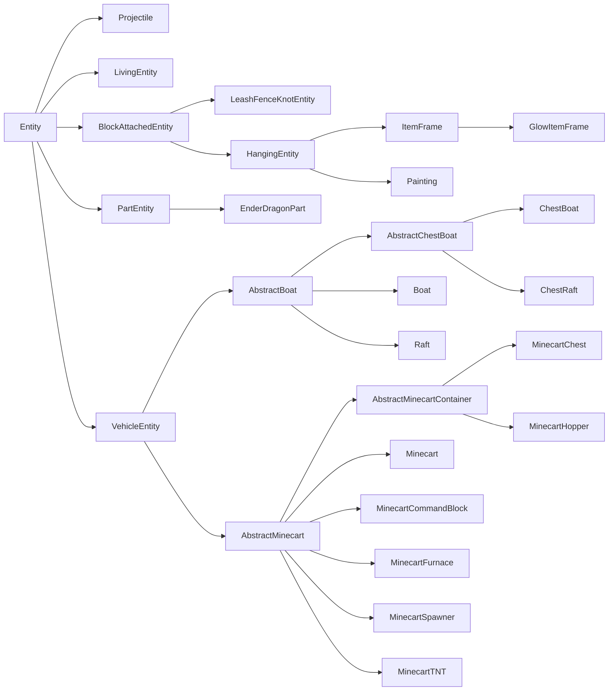
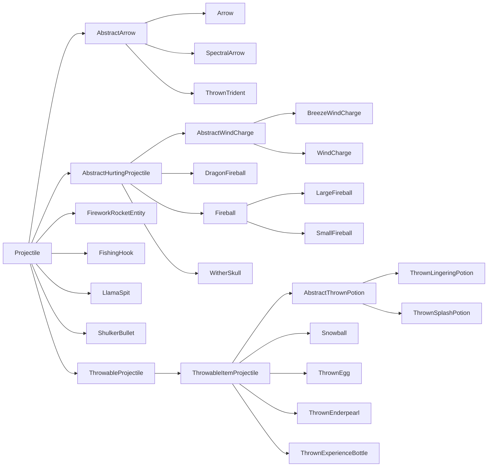

# 实体

实体是能以多种方式与世界交互的世界内对象。常见例子包括生物、弹射物、可骑乘对象，甚至玩家。每个实体都由多个系统组成，初看可能不易理解。本节拆解构建实体并使其按模组作者预期运行所需的关键组成部分。

## 术语

简单实体由三部分组成：

- [`Entity`][entity] 子类，保存实体的大部分逻辑。
- [`EntityType`][type]，经过[注册][registration]，保存一些通用属性。
- [`EntityRenderer`][renderer]，负责在游戏中显示实体。

更复杂的实体可能需要更多组成部分。例如，许多复杂 `EntityRenderer` 使用底层 `EntityModel` 实例；自然生成的实体还需要某种[生成机制][spawning]。

## `EntityType` {#entitytype}

`EntityType` 与 `Entity` 的关系类似于 [`Item`][item] 与 [`ItemStack`][itemstack]。`EntityType` 和 `Item` 一样是注册到相应注册表（实体类型注册表）的单例，保存该类型所有实体共有的值；`Entity` 和 `ItemStack` 一样，是这个单例类型的“实例”，保存该实体实例专属数据。关键区别在于，大多数行为并不定义在单例 `EntityType` 中，而定义在实例化的 `Entity` 类中。

假设已有继承 `Entity` 的 `MyEntity` 类（见[下文][entity]），现在创建实体类型注册表并注册 `EntityType`。除最后的 `#build` 外，`EntityType.Builder` 上的方法都是可选的。

```java
public static final DeferredRegister.Entities ENTITY_TYPES =
    DeferredRegister.createEntities(ExampleMod.MOD_ID);

public static final Supplier<EntityType<MyEntity>> MY_ENTITY = ENTITY_TYPES.register(
    "my_entity",
    // 使用构建器创建的实体类型。
    () -> EntityType.Builder.of(
        // EntityType.EntityFactory<T>，其中 T 是实体类，在这里为 MyEntity。
        // 可以把它理解为 BiFunction<EntityType<T>, Level, T>。
        // 通常引用实体构造方法。
        MyEntity::new,
        // 实体使用的 MobCategory，主要与生成有关。
        // 详见下文。
        MobCategory.MISC
    )
    // 宽度和高度，单位为方块。宽度同时用于两个水平方向。
    // 因此不支持非正方形底面。默认为 0.6f 和 1.8f。
    .sized(1.0f, 1.0f)
    // 用于不同体型生成生物的乘算缩放因子。
    // 原版只有史莱姆和岩浆怪使用，二者均为 4.0f。
    .spawnDimensionsScale(4.0f)
    // 眼睛高度，以尺寸底部为零点，单位为方块。默认为高度 * 0.85。
    // 必须在 #sized 之后调用才有效。
    .eyeHeight(0.5f)
    // 禁止通过 /summon 召唤实体。
    .noSummon()
    // 阻止实体保存到磁盘。
    .noSave()
    // 使实体免疫火焰。
    .fireImmune()
    // 使实体免疫某种方块的伤害。原版用此让狐狸免疫甜浆果丛、
    // 凋灵和凋灵骷髅免疫凋灵玫瑰、
    // 北极熊、雪傀儡和流浪者免疫细雪。
    .immuneTo(Blocks.POWDER_SNOW)
    // 禁用生成处理器中限制实体生成距离的规则。
    // 也就是无论与玩家距离多远，该实体都能生成。
    // 原版对掠夺者和潜影贝启用。
    .canSpawnFarFromPlayer()
    // 客户端保持该实体加载的范围，单位为区块。
    // 原版数值各异，常见为 8 或 10。默认为 5。
    // 注意，如果该值大于客户端区块视距，
    // 实际会使用客户端区块视距。
    .clientTrackingRange(8)
    // 实体的更新数据包发送频率，每隔多少个 tick 发送一次。
    // 对运动规律可预测的实体（例如弹射物）会设置较高值。默认为 3。
    .updateInterval(10)
    // 使用资源键构建实体类型。第二个参数应与实体 ID 相同。
    .build(ResourceKey.create(
        Registries.ENTITY_TYPE,
        Identifier.fromNamespaceAndPath("examplemod", "my_entity")
    ))
);

// 减少样板代码的简写。下面的调用等同于：
// ENTITY_TYPES.register("my_entity", () -> EntityType.Builder.of(MyEntity::new, MobCategory.MISC).build(
//     ResourceKey.create(Registries.ENTITY_TYPE, Identifier.fromNamespaceAndPath("examplemod", "my_entity"))
// );
public static final Supplier<EntityType<MyEntity>> MY_ENTITY =
    ENTITY_TYPES.registerEntityType("my_entity", MyEntity::new, MobCategory.MISC);

// 仍允许调用其他构建器方法的简写，
// 通过提供 UnaryOperator<EntityType.Builder> 参数实现。
public static final Supplier<EntityType<MyEntity>> MY_ENTITY = ENTITY_TYPES.registerEntityType(
    "my_entity", MyEntity::new, MobCategory.MISC,
    builder -> builder.sized(2.0f, 2.0f).eyeHeight(1.5f).updateInterval(5));
```

### `MobCategory` {#mobcategory}

_另见[自然生成][mobspawn]。_

实体的 `MobCategory` 决定与[生成和消失][mobspawn]相关的属性。原版默认添加八种 `MobCategory`：

| 名称 | 生成上限 | 示例 |
|------|----------|------|
| `MONSTER` | 70 | 各种怪物 |
| `CREATURE` | 10 | 各种动物 |
| `AMBIENT` | 15 | 蝙蝠 |
| `AXOLOTS` | 5 | 美西螈 |
| `UNDERGROUND_WATER_CREATURE` | 5 | 发光鱿鱼 |
| `WATER_CREATURE` | 5 | 鱿鱼、海豚 |
| `WATER_AMBIENT` | 20 | 鱼 |
| `MISC` | 不适用 | 所有非生物实体，例如弹射物；使用该分类会使实体完全无法自然生成 |

还有一些属性只在一两种 `MobCategory` 上设置：

- `isFriendly`：`MONSTER` 为 false，其他均为 true。
- `isPersistent`：`CREATURE` 和 `MISC` 为 true，其他均为 false。
- `despawnDistance`：`WATER_AMBIENT` 为 64，其他均为 128。

:::info
`MobCategory` 是[可扩展枚举][extenum]，可以添加自定义条目。如果这样做，也必须为该自定义分类的实体添加生成机制。
:::

## 实体类 {#the-entity-class}

首先创建 `Entity` 子类。除构造方法外，抽象类 `Entity` 定义四个必须实现的方法。前三个在[数据与网络同步文章][data]中说明，以避免本文过于冗长；`#hurtServer` 在[伤害实体][damaging]一节说明。

```java
public class MyEntity extends Entity {
    // 继承此构造方法，但泛型通配符没有边界。
    // 下面的注册需要边界，因此这里补上。
    public MyEntity(EntityType<? extends MyEntity> type, Level level) {
        super(type, level);
    }

    // 关于这些方法，见数据与网络同步文章。
    @Override
    protected void readAdditionalSaveData(ValueInput input) {}

    @Override
    protected void addAdditionalSaveData(ValueOutput output) {}

    @Override
    protected void defineSynchedData(SynchedEntityData.Builder builder) {}

    @Override
    public boolean hurtServer(ServerLevel level, DamageSource damageSource, float amount) {
        return true;
    }
}
```

:::info
虽然可以直接继承 `Entity`，但通常更适合以其众多子类之一作为基类。更多信息见[实体类继承结构][hierarchy]。
:::

如需从代码生成实体，也可以添加自定义构造方法。它们通常硬编码已注册实体类型的引用：

```java
public MyEntity(EntityType<? extends MyEntity> type, Level level, double x, double y, double z) {
    // 委托给工厂构造方法，并使用此前注册的 EntityType。
    this(type, level);
    this.setPos(x, y, z);
}
```

:::warning
自定义构造方法绝不能恰好有两个参数，否则会与上面的 `(EntityType, Level)` 构造方法混淆。
:::

接下来便可以自由实现实体功能。下面列出常见用例。

### 实体数据存储

_见[实体/数据与网络同步][data]。_

### 渲染实体

_见[实体/实体渲染器][renderer]。_

### 生成实体 {#spawning-entities}

启动游戏并进入世界后，目前只能通过 [`/summon`][summon] 命令生成实体（前提是没有调用 `EntityType.Builder#noSummon`）。

显然，还需要其他生成方式。最简单的是 `LevelWriter#addFreshEntity`，它接收 `Entity` 实例并加入世界：

```java
// 位于某个能取得 level 的方法中，仅服务端
if (!level.isClientSide()) {
    MyEntity entity = new MyEntity(level, 100.0, 200.0, 300.0);
    level.addFreshEntity(entity);
}
```

也可以调用 `EntityType#spawn`。生成[生物实体][livingentity]时尤其推荐，因为它会执行一些额外设置，例如触发生成[事件][event]。

大多数非生物实体都使用这种方式。玩家显然不应自行生成；`Mob` 有[自己的生成方式][mobspawn]（也可以通过 `#addFreshEntity` 加入）；原版[弹射物][projectile]在 `Projectile` 类中也有静态生成辅助方法。

### 伤害实体 {#damaging-entities}

_另见[左键单击物品][leftclick]。_

虽然并非所有实体都有生命值概念，但它们都能受到伤害。这不只用于生物和玩家：掉落的物品实体也会受到火焰或仙人掌等来源的伤害，通常会被立即删除。

可以通过 `Entity#hurt` 或 `Entity#hurtOrSimulate` 伤害实体，两者区别见下文。二者都接收两个参数：[`DamageSource`][damagesource] 和伤害量（float，以半颗心为单位）。例如 `entity.hurt(entity.damageSources().wither(), 4.25)` 会造成略多于两颗心的凋灵伤害。

实体也可以修改伤害行为。不能通过重写最终的 `#hurt` 方法实现，而应使用分别处理对应端伤害逻辑的 `#hurtServer` 和 `#hurtClient`。`#hurtClient` 常用于告诉客户端攻击已成功，即使事实未必如此，主要用于始终播放攻击音效等效果。要改变伤害行为，主要关注 `#hurtServer`：

```java
@Override
// 布尔返回值决定实体是否实际受到伤害。
public boolean hurtServer(ServerLevel level, DamageSource damageSource, float amount) {
    if (damageSource.is(DamageTypeTags.IS_FIRE)) {
        // 这里假设实现了 super#hurtServer()。其他常见方式是自行修改字段。
        // 原版不同实体的实现差异很大。
        // 特别地，生物实体通常会调用 #actuallyHurt，后者调用 #setHealth。
        return super.hurtServer(level, damageSource, amount * 2);
    } else {
        return false;
    }
}
```

这种服务端/客户端分离也是 `Entity#hurt` 和 `Entity#hurtOrSimulate` 的区别：`Entity#hurt` 只在服务端运行（并调用 `Entity#hurtServer`）；`Entity#hurtOrSimulate` 在两个端都运行，并根据端调用 `Entity#hurtServer` 或 `Entity#hurtClient`。

也可以通过事件修改对不属于自己的实体（即 Minecraft 或其他模组添加的实体）造成的伤害。这些事件包含大量 `LivingEntity` 专属代码，因此文档位于[生物实体文章][livingentity]的[伤害事件][damageevents]一节。

### 实体 Tick

通常希望实体每个 tick 执行某种操作（例如移动）。该逻辑分为几个方法：

- `#tick`：中心 tick 方法，99% 的情况下应重写它。
    - 默认转发到 `#baseTick`，但几乎所有子类都会重写它。
- `#baseTick`：处理所有实体的通用值更新，包括着火状态、细雪冻结、游泳状态和传送门传送。`LivingEntity` 还在这里处理溺水、方块内伤害和伤害追踪器更新。要改变或扩展该逻辑时重写此方法。
    - 默认情况下，`Entity#tick` 会转发到它。
- `#rideTick`：其他实体的乘客会调用它，例如骑马的玩家，或使用 `/ride` 命令骑乘其他实体的任何实体。
    - 默认执行一些检查后调用 `#tick`。骷髅和玩家会重写它以特殊处理骑乘。

实体还有一个字段 `tickCount`，表示实体在世界中存在了多少 tick；以及布尔字段 `firstTick`。例如，每 5 个 tick [生成一次粒子][particle]：

```java
@Override
public void tick() {
    // 除非有充分理由，否则始终调用 super。
    super.tick();
    // 每 5 个 tick 执行一次。
    if (this.tickCount % 5 == 0) {
        this.level().addParticle(...);
    }
}
```

### 选取实体

_另见[中键单击][middleclick]。_

选取是指选中玩家当前看向的对象，并取得关联物品。实体可以修改中键单击的结果（“选取结果”）。`Mob` 类会自动选择正确的刷怪蛋：

```java
@Override
@Nullable
public ItemStack getPickResult() {
    // 假设 MY_CUSTOM_ITEM 是 DeferredItem<?>，详见物品文章。
    // 如果实体不应可被选取，建议返回 null。
    return new ItemStack(MY_CUSTOM_ITEM.get());
}
```

实体通常应可被选取，但少数情况并非如此。原版末影龙由多个部分组成，其父实体禁用了选取，而各部分重新启用，以便更细致地调整碰撞箱。

类似地，也可以完全禁用实体选取：

```java
@Override
public boolean isPickable() {
    // 如有需要，可在这里执行额外检查。
    return false;
}
```

如果要自行执行选取（即射线检测），可以对射线起点实体调用 `Entity#pick`。返回的 [`HitResult`][hitresult] 可用于进一步检查射线实际命中了什么。

### 实体附着点

_不要与[数据附件][dataattachments]混淆。_

实体附着点用于定义实体的视觉附着位置，例如乘客或名称标签相对于实体本身显示在哪里。实体本身只控制附着点的默认位置，附着点可以再定义相对该默认位置的偏移。

构建 `EntityType` 时，可以调用 `EntityType.Builder#attach` 设置任意数量的附着点。该方法接收 `EntityAttachment` 以及三个 float 坐标（x/y/z）。坐标应相对于该附着点的默认位置。

原版定义四个 `EntityAttachment`：

| 名称 | 默认位置 | 用途 |
|------|----------|------|
| `PASSENGER` | 碰撞箱中心 X/顶部 Y/中心 Z | 马等可骑乘实体，用于定义乘客出现位置 |
| `VEHICLE` | 碰撞箱中心 X/底部 Y/中心 Z | 所有实体，用于定义骑乘其他实体时出现的位置 |
| `NAME_TAG` | 碰撞箱中心 X/顶部 Y/中心 Z | 定义实体名称标签的显示位置（如适用） |
| `WARDEN_CHEST` | 碰撞箱中心 X/中心 Y/中心 Z | 监守者用于定义音爆攻击的起点 |

:::info
`PASSENGER` 和 `VEHICLE` 在同一上下文中相关：先应用 `PASSENGER` 定位骑乘者，再在骑乘者身上应用 `VEHICLE`。
:::

每个附着点都可视为 `EntityAttachment` 到 `List<Vec3>` 的映射。实际使用多少点取决于消费系统。例如船和骆驼使用两个 `PASSENGER` 点，马或矿车只使用一个。

`EntityType.Builder` 也提供相关辅助方法：

- `#passengerAttachment()`：定义 `PASSENGER` 附着点，有两个变体。
    - 一个接收 `Vec3...` 附着点。
    - 另一个接收 `float...`，把每个 float 作为 y 值、x 和 z 设为 0，再转发到 `Vec3...` 变体。
- `#vehicleAttachment()`：定义 `VEHICLE` 附着点，接收 `Vec3`。
- `#ridingOffset()`：定义 `VEHICLE` 附着点，接收 float，并以 x、z 为 0、y 为该 float 的负值构造 `Vec3`，转发到 `#vehicleAttachment()`。
- `#nameTagOffset()`：定义 `NAME_TAG` 附着点，接收 float 作为 y 值，x 和 z 为 0。

也可以调用 `EntityAttachments#builder()`，再对构建器调用 `#attach()` 自行定义：

```java
// 位于某个 EntityType<?> 创建过程中
EntityType.Builder.of(...)
    // 该附着点使名称标签悬浮在地面上方半格。
    // 未设置时，默认使用实体碰撞箱高度。
    .attach(EntityAttachment.NAME_TAG, 0, 0.5f, 0)
    .build();
```

## 实体类继承结构 {#entity-class-hierarchy}

由于实体种类繁多，`Entity` 子类形成复杂继承结构。创建自定义实体时，了解这些结构有助于选择合适的父类并复用代码。

原版实体继承结构如下：



_<span class="mermaid-desc-yellow">黄色</span>类为 `abstract`，<span class="mermaid-desc-blue">蓝色</span>类不是 `abstract`。_

逐个说明：

- `Projectile`：各种弹射物的基类，包括箭、火球、雪球、烟花火箭等。详见[下文][projectile]。
- `LivingEntity`：所有“有生命”实体的基类，具有生命值、装备、[生物效果][mobeffect]等属性，包括怪物、动物、村民和玩家。详见[生物实体文章][livingentity]。
- `BlockAttachedEntity`：固定在方块上的不可移动实体基类，包括拴绳结、物品展示框和画。其子类主要用于复用代码。
- `PartEntity`：NeoForge 添加的多部分实体基类，即由多个小实体组成的实体。`EnderDragonPart` 已被修改为继承 `PartEntity` 而不是 `Entity`。
- `VehicleEntity`：船和矿车的基类。虽然它们与 `LivingEntity` 一样有生命值概念，但其他共同属性很少，因此单独分组。其子类主要用于复用代码。

还有一些实体直接继承 `Entity`，仅仅因为找不到更合适的父类。大多数从名称即可理解：

- `AreaEffectCloud`（滞留药水云）
- `EndCrystal`
- `EvokerFangs`
- `ExperienceOrb`
- `EyeOfEnder`
- `FallingBlockEntity`（下落沙子、沙砾等）
- `ItemEntity`（掉落物品）
- `LightningBolt`
- `OminousItemSpawner`（持续生成试炼刷怪笼战利品）
- `PrimedTnt`

上图和列表不包括地图制作者使用的实体（显示实体、交互实体和标记）。

### 弹射物 {#projectiles}

弹射物是实体子组。它们的共同点是会沿一个方向飞行直到命中，并且有归属者（例如箭的归属者可以是玩家或骷髅，火球的归属者可以是恶魂）。

弹射物继承结构如下（黄色类为 `abstract`，蓝色类不是）：



_<span class="mermaid-desc-yellow">黄色</span>类为 `abstract`，<span class="mermaid-desc-blue">蓝色</span>类不是 `abstract`。_

值得注意的是 `Projectile` 的三个直接抽象子类：

- `AbstractArrow`：表示各种箭和三叉戟。共同点是飞行轨迹并非直线，而会受到重力影响。
- `AbstractHurtingProjectile`：表示风弹、各种火球和凋灵之首。这些造成伤害的弹射物不受重力影响。
- `ThrowableProjectile`：表示鸡蛋、雪球和末影珍珠等。它们像箭一样受重力影响，但命中目标时不会造成伤害；它们都通过对应[物品][item]生成。

继承 `Projectile` 或合适的子类，并重写实现功能所需的方法，即可创建新弹射物。常见重写方法包括：

- `#shoot`：计算并设置弹射物的正确速度。
- `#onHit`：命中时调用。
    - `#onHitEntity`：命中[实体][entity]时调用。
    - `#onHitBlock`：命中[方块][block]时调用。
- `#getOwner` 和 `#setOwner`：取得和设置所属实体。
- `#deflect`：根据传入的 `ProjectileDeflection` 枚举值使弹射物偏转。
- `#onDeflection`：由 `#deflect` 调用，处理偏转后的行为。

[block]: ../blocks/index.md
[damageevents]: livingentity.md#damage-events
[damagesource]: ../resources/server/damagetypes.md#creating-and-using-damage-sources
[damaging]: #damaging-entities
[data]: data.md
[dataattachments]: ../datastorage/attachments.md
[entity]: #the-entity-class
[event]: ../concepts/events.md
[extenum]: ../advanced/extensibleenums.md
[hierarchy]: #entity-class-hierarchy
[hitresult]: ../items/interactions.md#hitresults
[item]: ../items/index.md
[itemstack]: ../items/index.md#itemstacks
[leftclick]: ../items/interactions.md#left-clicking-an-item
[livingentity]: livingentity.md
[middleclick]: ../items/interactions.md#middle-clicking
[mobeffect]: ../items/mobeffects.md
[mobspawn]: livingentity.md#spawning
[particle]: ../resources/client/particles.md
[projectile]: #projectiles
[registration]: ../concepts/registries.md#methods-for-registering
[renderer]: renderer.md
[spawning]: #spawning-entities
[summon]: https://minecraft.wiki/w/Commands/summon
[type]: #entitytype
