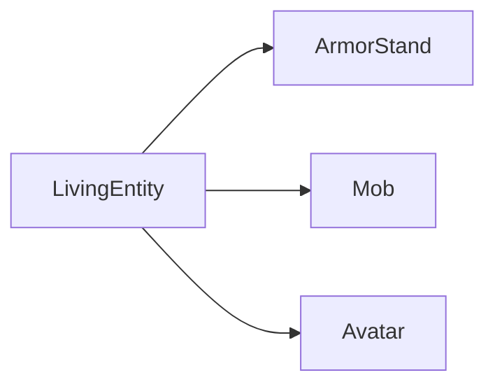
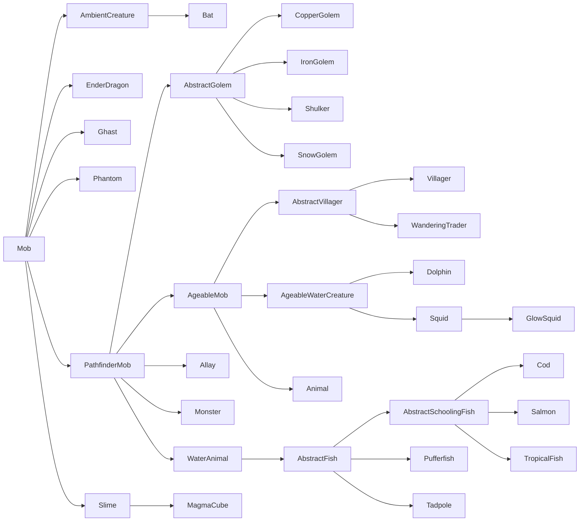
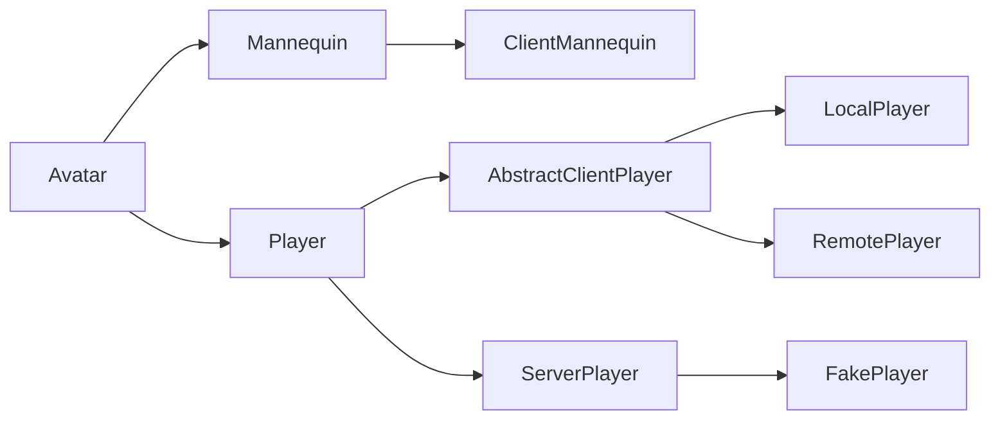

# 生物实体、生物与玩家

生物实体是[实体][entities]中的一大子组，全部继承自共同父类 `LivingEntity`。其中包括生物（通过 `Mob` 子类）、玩家（通过 `Player` 子类）和盔甲架（通过 `ArmorStand` 子类）。

生物实体具有普通实体没有的额外属性，包括[属性][attributes]、[生物效果][mobeffects]、伤害追踪等。

## 生命、伤害与治疗

_另见：[属性][attributes]。_

生物实体最显著的特征之一是完整的生命系统。生物实体通常有最大生命值、当前生命值，有时还有盔甲或自然恢复等机制。

默认情况下，最大生命值由 `minecraft:max_health` [属性][attributes]决定，实体[生成][spawning]时当前生命值设为相同数值。调用 [`Entity#hurtServer`][hurt] 伤害实体时，会根据伤害计算降低当前生命值。僵尸等许多实体会保持降低后的生命值，而玩家等一些实体可以重新恢复失去的生命值。

可以直接读写属性来取得或设置最大生命值：

```java
// 取得实体的属性映射。
AttributeMap attributes = entity.getAttributes();

// 取得实体的最大生命值。
float maxHealth = attributes.getValue(Attributes.MAX_HEALTH);
// 上面的快捷写法。
maxHealth = entity.getMaxHealth();

// 设置最大生命值必须取得 AttributeInstance 并调用 #setBaseValue，
// 或添加属性修饰符。这里使用前一种方法。详见属性文章。
attributes.getInstance(Attributes.MAX_HEALTH).setBaseValue(50);
```

[受到伤害][damage]时，生物实体还会执行额外计算，例如考虑 `minecraft:armor` 属性（`minecraft:bypasses_armor` [标签][tags]中的[伤害类型][damagetypes]除外）以及 `minecraft:absorption` 属性。生物实体还可以重写 `#onDamageTaken` 执行攻击后的行为；只有最终伤害大于 0 时才调用。

### 伤害事件 {#damage-events}

伤害流程很复杂，因此提供多个可按下列顺序触发的事件。它们主要用于修改不一定是自己实体受到的伤害，例如 Minecraft 或其他模组添加的实体受到的伤害，或任何实体受到的伤害。

所有事件都涉及 `DamageContainer`。攻击开始时创建新的 `DamageContainer`，攻击结束后丢弃。它包含原始 [`DamageSource`][damagesources]、原始伤害量，以及所有单独修改（盔甲、伤害吸收、[附魔][enchantments]、[生物效果][mobeffects]等）的列表。`DamageContainer` 会传给以下所有事件，可以检查已经做了哪些修改，再据此调整自己的逻辑。

#### `EntityInvulnerabilityCheckEvent`

该事件允许模组绕过或添加实体无敌。非生物实体也会触发。可用于让实体免疫某种攻击，或移除已有免疫。

由于技术原因，该事件的钩子必须具有确定性，并且只能依赖伤害类型。因此，随机无敌，或只对低于一定伤害量生效的无敌，应改在 `LivingIncomingDamageEvent` 中添加（见下文）。

#### `LivingIncomingDamageEvent`

该事件只在服务端调用，有两个主要用途：动态取消攻击，以及添加减伤修饰符回调。

动态取消攻击本质上是添加非确定性无敌，例如按概率取消伤害、根据一天中的时间或受到的伤害量决定无敌等。稳定的无敌应通过 `EntityInvulnerabilityCheckEvent` 实现。

减伤修饰符回调可用于修改某一部分伤害减免。例如把盔甲减伤效果降低 50%，后续生物效果会获得不同的伤害量。添加回调：

```java
@SubscribeEvent // 在游戏事件总线上
public static void decreaseArmor(LivingIncomingDamageEvent event) {
    // 只对玩家应用该降低，僵尸等保持不变
    if (event.getEntity() instanceof Player) {
        // 添加减伤修饰符回调。
        event.addReductionModifier(
            // 目标减伤。可选值见 DamageContainer.Reduction 枚举。
            DamageContainer.Reduction.ARMOR,
            // 要执行的修改。接收伤害容器和基础减伤，输出新减伤。
            // 输入输出减伤均为 float。
            (container, baseReduction) -> baseReduction * 0.5f
        );
    }
}
```

回调按添加顺序应用。因此，在[优先级][priority]更高的事件处理器中添加的回调会先运行。

#### `LivingShieldBlockEvent`

该事件可完整自定义盾牌格挡，包括添加额外格挡、阻止格挡、修改原版盾牌格挡检查、改变盾牌或攻击物品受到的伤害、改变盾牌视野弧度、允许弹射物但格挡近战（或相反）、被动格挡（不主动使用盾牌）、只格挡部分伤害等。

注意，该事件并非用于“盾牌类物品”范围之外的免疫或取消攻击。

#### `ArmorHurtEvent`

该事件在计算攻击造成的盔甲损耗时触发，可修改特定盔甲受到多少耐久伤害（也可以完全不损耗）。

#### `LivingDamageEvent.Pre`

伤害实际执行前调用。此时 `DamageContainer` 已完整填充，最终伤害值可用，并且事件不能再取消，因为攻击已被视为成功。

此时各种修饰符都可以使用，可精细修改伤害量。注意，盔甲损耗等逻辑已经在此前完成。

#### `LivingDamageEvent.Post`

伤害执行后调用，此时伤害吸收已扣减、战斗追踪器已更新、统计和游戏事件已处理。事件不可取消，因为攻击已经发生。通常用于攻击后效果。注意，即使伤害为 0 也会触发，因此必要时检查数值。

如果操作的是自己的实体，应考虑改为重写 `ILivingEntityExtension#onDamageTaken()`。与 `LivingDamageEvent.Post` 不同，它只在伤害大于 0 时调用。

## 生物效果

_见[生物效果与药水][mobeffects]。_

## 装备

_见[实体上的容器][containers]。_

## 继承结构

生物实体有复杂的类继承结构。前面提到，它有三个直接子类：



_<span class="mermaid-desc-yellow">黄色</span>类为 `abstract`，<span class="mermaid-desc-blue">蓝色</span>类不是 `abstract`。_

其中 `ArmorStand` 没有子类，并且是唯一非 abstract 的类，因此下面重点介绍 `Mob` 和 `Avatar`。

### `Mob` 的继承结构

`Mob` 的继承结构如下：



_<span class="mermaid-desc-yellow">黄色</span>类为 `abstract`，<span class="mermaid-desc-blue">蓝色</span>类不是 `abstract`。_

图中未列出的其他生物实体都是 `Animal` 或 `Monster` 的子类。

继承结构相当杂乱。例如蜜蜂和鹦鹉为何不是飞行生物的共同子类。查看 `Animal` 和 `Monster` 的子类结构会更复杂，这里不详细展开；如有兴趣，可使用 IDE 的 Show Hierarchy 功能查看。最好接受这一点，不必过度纠结。

最重要的类如下：

- `PathfinderMob`：包含寻路逻辑。
- `AgeableMob`：包含成长和幼年实体逻辑。有幼年变体的僵尸等怪物不继承它，而是继承 `Monster`。
- `Animal`：大多数动物继承它。还有 `AbstractHorse`、`TamableAnimal` 等抽象子类。
- `Monster`：游戏视为怪物的大多数实体的抽象类。与 `Animal` 一样有 `AbstractPiglin`、`AbstractSkeleton`、`Raider`、`Zombie` 等抽象子类。
- `WaterAnimal`：鱼、鱿鱼和海豚等水生动物的抽象类。由于寻路差异显著，它们与其他动物分开。

### `Avatar` 的继承结构

Avatar 不只表示玩家，也表示类似玩家的假人。根据所在端使用不同类。除了 `FakePlayer` 和 `Mannequin`，通常不应自行构造 avatar。



_<span class="mermaid-desc-yellow">黄色</span>类为 `abstract`，<span class="mermaid-desc-blue">蓝色</span>类不是 `abstract`。_

- `AbstractClientPlayer`：两种客户端玩家的基类，用于表示[逻辑客户端][logicalsides]上的玩家。
- `LocalPlayer`：表示当前运行游戏的玩家。
- `RemotePlayer`：表示 `LocalPlayer` 在多人游戏中遇到的其他玩家，因此单人游戏中不存在。
- `ServerPlayer`：表示[逻辑服务端][logicalsides]上的玩家。
- `FakePlayer`：`ServerPlayer` 的特殊子类，用于为需要玩家上下文的非玩家机制提供模拟玩家。
- `Mannequin`：可摆姿势的玩家式假人，通常没有 AI。
- `ClientMannequin`：表示[逻辑客户端][logicalsides]上的假人。

## 生成 {#spawning}

除了[常规生成方式][spawning]（`/summon` 命令，以及代码中的 `EntityType#spawn` 或 `Level#addFreshEntity`），`Mob` 还可以通过其他方式生成。`ArmorStand` 可使用常规方式，玩家不应自行实例化，`FakePlayer` 除外。

### 刷怪蛋

生物通常会[注册]刷怪蛋，但并非必需。刷怪蛋通过 `SpawnEggItem` 和 `DataComponents#ENTITY_DATA` [数据组件][datacomponent]实现：

```java
// 假设存在名为 ITEMS 的 DeferredRegister.Items
DeferredItem<SpawnEggItem> MY_ENTITY_SPAWN_EGG = ITEMS.registerItem("my_entity_spawn_egg",
    properties -> new SpawnEggItem(
        // 传给 lambda 的属性。
        // 使用 `spawnEgg` 设置数据组件。
        // 在 lambda 中设置可避免实体类型在注册完成前解析。
        properties.spawnEgg(MY_ENTITY_TYPE.get())
    ));
```

它也是普通物品，因此应加入[创造模式标签页][creative]，并提供[客户端物品][clientitem]、[模型][model]和[翻译][translation]。

### 生成位置

默认情况下，实体可以在任何位置生成，包括方块内部和半空中。要限制生成位置，必须注册生成位置放置规则。通过 `RegisterSpawnPlacementsEvent` 完成：

```java
@SubscribeEvent // 在模组事件总线上
public static void registerSpawnPlacements(RegisterSpawnPlacementsEvent event) {
    event.register(
        // 要为其注册生成位置的 EntityType<?>。
        MY_ENTITY.get(),
        // SpawnPlacementType 是检查位置是否适合生成的函数式接口。
        // 如有需要可以添加自己的类型，参考 SpawnPlacementTypes 的实现。
        // 原版值包括 NO_RESTRICTIONS、IN_WATER、IN_LAVA 和 ON_GROUND。
        SpawnPlacementTypes.ON_GROUND,
        // 使用的高度图类型，在世界生成期间提供初始高度。
        // 可能值：WORLD_SURFACE、OCEAN_FLOOR、MOTION_BLOCKING、MOTION_BLOCKING_NO_LEAVES。
        Heightmap.Types.WORLD_SURFACE,
        // 额外生成规则谓词，例如光照。可以写成 lambda，
        // 也可以（更常见地）写成实体类静态方法。
        (entityType, level, spawnReason, pos, random) -> {
            // 让生物只生成在草方块上。
            return level.getBlockState(pos.below()).is(Blocks.GRASS_BLOCK)
                || Mob.checkMobSpawnRules(entityType, level, spawnReason, pos, random);
        },
        // 对自己模组的生物可使用任意操作。
        RegisterSpawnPlacementsEvent.Operation.OR
    );
}
```

也可以修改原版或其他模组的生成位置。使用 `Operation.AND`（增加限制）、`Operation.OR`（增加替代生成机制）或 `Operation.REPLACE`（完全替换，此时应使用[低优先级事件监听器][priority]）：

```java
@SubscribeEvent // 在模组事件总线上
public static void registerSpawnPlacements(RegisterSpawnPlacementsEvent event) {
    event.register(
        // 要为其注册生成位置的 EntityType<?>。
        MY_ENTITY.get(),
        // 不使用 Operation.REPLACE 时，生成位置类型
        // 和高度图类型应留为 null。
        null,
        null,
        // 与上面一样检查额外或替代生成规则。
        (entityType, level, spawnReason, pos, random) -> {
            return level.getBlockState(pos.below()).is(Blocks.GRASS_BLOCK)
                || Mob.checkMobSpawnRules(entityType, level, spawnReason, pos, random);
        },
        // 使用合适的 Operation。
        RegisterSpawnPlacementsEvent.Operation.AND
    );
}
```

事件还提供两个工具重载（其中 `spawnPredicate` 就是前面的 lambda）：

```java
@SubscribeEvent // 在模组事件总线上
public static void registerSpawnPlacements(RegisterSpawnPlacementsEvent event) {
    // 等同于 event.register(MY_ENTITY.get(), null, null, spawnPredicate, Operation.OR)
    event.register(MY_ENTITY.get(), spawnPredicate);
    // 等同于 event.register(MY_ENTITY.get(), null, null, spawnPredicate, operation)
    event.register(MY_ENTITY.get(), spawnPredicate, operation);
}
```

### 自然生成 {#natural-spawning}

_另见[实体/`MobCategory`][mobcategory]、[世界生成/生物群系修改器/添加生成][addspawns]、[添加生成成本][addspawncosts]，以及 [Minecraft Wiki][mcwiki]上的[生成周期][spawncycle]。_

对于 `MobCategory#isFriendly()` 为 true 的实体（默认所有非怪物实体），每个 tick 执行自然生成；对于为 false 的实体（所有怪物），每 400 个 tick（20 秒）执行一次。如果 `MobCategory#isPersistent()` 返回 true（主要是动物），区块生成时也会执行该过程。

对于每个区块和生物分类，会检查是否达到生成上限。更准确地说，检查周围 `loadedChunks` 区域中该 `MobCategory` 的实体数是否少于 `MobCategory#getMaxInstancesPerChunk() * loadedChunks / 289`；`loadedChunks` 最多是当前区块周围 17×17 的区域，加载区块较少时则相应减少。

接下来，每个区块还必须满足至少一名玩家附近（距离 <= 128）该 `MobCategory` 的实体数少于 `MobCategory#getMaxInstancesPerChunk()`，该分类才会生成。

条件满足后，从相关生物群系生成数据中随机选择一个条目，如能找到合适位置就生成。最多尝试三次随机位置；找不到位置则不生成。

#### 示例

以平原生物群系中的动物为例。每个 tick，游戏都会尝试生成 `CREATURE` 分类的实体，其中包含：

```json5
[
    {"type": "minecraft:sheep",   "minCount": 4, "maxCount": 4, "weight": 12},
    {"type": "minecraft:pig",     "minCount": 4, "maxCount": 4, "weight": 10},
    {"type": "minecraft:chicken", "minCount": 4, "maxCount": 4, "weight": 10},
    {"type": "minecraft:cow",     "minCount": 4, "maxCount": 4, "weight": 8 },
    {"type": "minecraft:horse",   "minCount": 2, "maxCount": 6, "weight": 5 },
    {"type": "minecraft:donkey",  "minCount": 1, "maxCount": 3, "weight": 1 }
]
```

`CREATURE` 上限为 10，因此会扫描每名玩家当前区块周围最多 17×17 的区块，寻找其他 `CREATURE` 实体。如果找到的实体数 <= 10 * chunkCount / 289（这基本上意味着靠近未加载区块时生成概率更高），就对每个实体与最近玩家做距离检查。只要至少有一个实体的距离大于 128，就可以生成。

所有检查通过后，根据权重从列表选择生成条目。假设选中猪，游戏会检查区块中的随机位置是否适合生成，适合时按生成数据的最小和最大数量生成（此例正好生成 4 头猪）。如果不适合，再尝试两个不同位置；仍找不到就取消生成。

[addspawncosts]: ../worldgen/biomemodifier.md#add-spawn-costs
[addspawns]: ../worldgen/biomemodifier.md#add-spawns
[attributes]: attributes.md
[clientitem]: ../resources/client/models/items.md
[containers]: ../inventories/container.md
[creative]: ../items/index.md#creative-tabs
[damage]: index.md#damaging-entities
[damagesources]: ../resources/server/damagetypes.md#creating-and-using-damage-sources
[damagetypes]: ../resources/server/damagetypes.md
[datacomponent]: ../items/datacomponents.md
[enchantments]: ../resources/server/enchantments/index.md
[entities]: index.md
[hurt]: index.md#damaging-entities
[logicalsides]: ../concepts/sides.md#the-logical-side
[mcwiki]: https://minecraft.wiki
[mobcategory]: index.md#mobcategory
[mobeffects]: ../items/mobeffects.md
[model]: ../resources/client/models/index.md
[priority]: ../concepts/events.md#priority
[register]: ../concepts/registries.md
[spawncycle]: https://minecraft.wiki/w/Mob_spawning#Spawn_cycle
[spawning]: index.md#spawning-entities
[tags]: ../resources/server/tags.md
[translation]: ../resources/client/i18n.md
