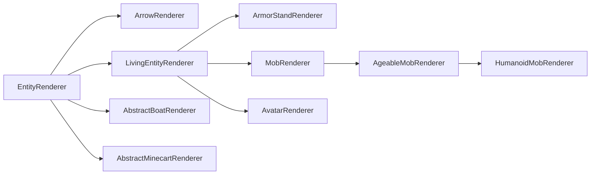

# 实体渲染器 {#entity-renderers}

实体渲染器定义实体的渲染行为，只存在于[逻辑客户端和物理客户端][sides]。

实体渲染使用所谓“实体渲染状态”。简单来说，渲染状态是保存渲染器所需全部值的对象。每次渲染实体时都会更新渲染状态，随后 `#submit` 方法用它提交延迟渲染实体所需的[特性][features]。

## 创建实体渲染器

最简单的实体渲染器直接继承 `EntityRenderer`：

```java
// 父类泛型应设置为要渲染的实体类型。
// 如果要为任何实体启用渲染，就像这里一样使用 Entity。
// 还应使用适合具体用途的 EntityRenderState。详见下文。
public class MyEntityRenderer extends EntityRenderer<Entity, EntityRenderState> {
    // 构造方法直接转发给父类。
    public MyEntityRenderer(EntityRendererProvider.Context context) {
        super(context);
    }

    // 告诉渲染引擎如何创建新的实体渲染状态。
    @Override
    public EntityRenderState createRenderState() {
        return new EntityRenderState();
    }

    // 把传入实体中需要的值复制到传入状态，从而更新渲染状态。
    // Entity 和 EntityRenderState 可替换为更具体的类型，
    // 与传给父类的泛型一致。
    @Override
    public void extractRenderState(Entity entity, EntityRenderState state, float partialTick) {
        super.extractRenderState(entity, state, partialTick);
        // 在这里提取并保存其他值。
    }

    // 实际提交实体的渲染特性。
    // 第一个参数与渲染状态泛型一致。
    // 如适用，调用 super 会处理拴绳和名称标签提交。
    @Override
    public void submit(EntityRenderState renderState, PoseStack poseStack, SubmitNodeCollector collector, CameraRenderState cameraState) {
        super.submit(renderState, poseStack, collector, cameraState);
        // 在这里执行自己的提交
    }
}
```

创建实体渲染器后，还需要注册并连接到所属实体。通过 [`EntityRenderersEvent.RegisterRenderers`][events]完成：

```java
@SubscribeEvent // 在物理客户端的模组事件总线上
public static void registerEntityRenderers(EntityRenderersEvent.RegisterRenderers event) {
    event.registerEntityRenderer(MY_ENTITY_TYPE.get(), MyEntityRenderer::new);
}
```

## 实体渲染状态

实体渲染状态把渲染值与实际实体的值分离。它只是可变的数据存储对象，因此扩展非常简单：

```java
public class MyEntityRenderState extends EntityRenderState {
    public ItemStackRenderState stackInHand;
}
```

只需继承类、添加字段，并把 `EntityRenderer` 的泛型改为自己的类。最后在 `EntityRenderer#extractRenderState` 中更新 `stackInHand` 字段。

### 修改渲染状态

NeoForge 除了允许定义新实体渲染状态，还提供修改现有渲染状态的系统。

创建一个 `ContextKey<T>`（`T` 是数据值类型）并保存到静态字段，然后在 `RegisterRenderStateModifiersEvent` 的事件处理器中使用：

```java
public static final ContextKey<String> EXAMPLE_CONTEXT = new ContextKey<>(
    // 上下文键 ID，用于在内部区分不同键。
    Identifier.fromNamespaceAndPath("examplemod", "example_context"));

@SubscribeEvent // 在物理客户端的模组事件总线上
public static void registerRenderStateModifiers(RegisterRenderStateModifiersEvent event) {
    event.registerEntityModifier(
        // 渲染器的 TypeToken。由于泛型机制，必须以匿名类创建（即末尾带 {}），
        // 并显式写出泛型参数。
        new TypeToken<LivingEntityRenderer<LivingEntity, LivingEntityRenderState, ?>>(){},
        // 修饰器本身。它是接收实体和实体渲染状态的 BiConsumer。
        // 具体泛型由渲染器类的泛型推断。
        (entity, state) -> state.setRenderData(EXAMPLE_CONTEXT, "Hello World!");
    );

    // 上面的重载，接收 Class<?>。
    // 只应用于没有泛型的渲染器，例如 PigRenderer。
    event.registerEntityModifier(
        PigRenderer.class,
        (entity, state) -> state.setRenderData(EXAMPLE_CONTEXT, "Hello World!");
    );

    // 用于绕过修改 avatar（例如玩家）渲染状态问题的便捷方法。
    event.registerAvatarEntityModifier(new AvatarRenderStateModifier() {
        @Override
        public <T extends Avatar & ClientAvatarEntity> void accept(T avatar, AvatarRenderState state) {
            state.setRenderData(EXAMPLE_CONTEXT, "Hello World!");
        }
    });
}
```

:::tip
向 `EntityRenderState#setRenderData` 的第二个参数传入 `null` 可清除值，例如：

```java
state.setRenderData(EXAMPLE_CONTEXT, null);
```
:::

之后可在需要时通过 `EntityRenderState#getRenderData` 取得数据，也可使用 `#getRenderDataOrThrow` 和 `#getRenderDataOrDefault`。

## 继承结构

实体渲染器也有继承结构，但没有实体类那么多层。重要类的关系如下：



_<span class="mermaid-desc-yellow">黄色</span>类为 `abstract`，<span class="mermaid-desc-blue">蓝色</span>类不是 `abstract`。_

- `EntityRenderer`：抽象基类。许多渲染器（特别几乎所有非生物实体渲染器）直接继承它。
- `ArrowRenderer`、`AbstractBoatRenderer`、`AbstractMinecartRenderer`：主要用于便利和作为更具体渲染器的父类。
- `LivingEntityRenderer`：[生物实体][livingentity]渲染器的抽象基类，直接子类包括 `ArmorStandRenderer` 和 `AvatarRenderer`。
- `ArmorStandRenderer`：盔甲架渲染器。
- `AvatarRenderer`：渲染玩家等 avatar。与大多数渲染器不同，同一时间可以存在多个用于不同上下文的实例。
- `MobRenderer`：`Mob` 渲染器的抽象基类，许多渲染器直接继承它。
- `AgeableMobRenderer`：有幼年变体的 `Mob` 渲染器的抽象基类，包括疣猪兽等有幼年变体的怪物。
- `HumanoidMobRenderer`：人形实体渲染器的抽象基类，僵尸和骷髅等使用。

应选择最符合用途的类。注意，这些类通常有泛型边界，例如 `LivingEntityRenderer` 对 `LivingEntity` 和 `LivingEntityRenderState` 有边界。

## 实体模型、层定义与渲染层

较复杂的实体渲染器（尤其 `LivingEntityRenderer`）使用层系统，每层由 `RenderLayer` 表示。一个渲染器可以使用多个 `RenderLayer`，并决定何时提交哪些层。例如鞘翅使用独立层，由穿着它的 `LivingEntity` 独立处理；玩家披风也是一个独立层。

`RenderLayer` 定义 `#submit` 方法，用于提交层所需的[特性][features]。这里可以提交任意内容，最常见的用途是提交独立模型，例如盔甲或类似装备。

为此首先需要可提交的模型。`Model` 类基本是立方体列表和关联贴图。通常在实体渲染器首次创建构造方法时静态创建。

:::note
下面开始操作 `LivingEntityRenderer`，因此假设 `MyEntity extends LivingEntity`，`MyEntityRenderState extends LivingEntityRenderState`，以满足泛型边界。
:::

### 创建实体模型类和层定义

首先创建实体模型类：

```java
public class MyEntityModel extends EntityModel<MyEntityRenderState> {}
```

这里直接继承 `EntityModel`；根据用途，可能更适合使用其子类，甚至直接使用 `Model` 或非实体相关的 `Model` 子类。创建新模型时，建议参考与需求最接近的现有模型。

接下来创建 `LayerDefinition`。它基本是立方体列表，随后可烘焙成 `EntityModel`。定义如下：

```java
public class MyEntityModel extends EntityModel<MyEntityRenderState> {
    // 创建层定义的静态方法。多数原版模型使用 createBodyLayer 这个名称。
    // 如果有多个层，就会有多个此类静态方法。
    public static LayerDefinition createBodyLayer() {
        // 创建网格。
        MeshDefinition mesh = new MeshDefinition();
        // 初始网格只包含不可见的根对象（尺寸 0x0x0）。
        PartDefinition root = mesh.getRoot();
        // 添加头部部件。
        PartDefinition head = root.addOrReplaceChild(
            // 部件名称。
            "head",
            // 要添加的 CubeListBuilder。
            CubeListBuilder.create()
                // 贴图中的 UV 坐标。贴图绑定见下文。
                // 本例从 U=10、V=20 开始。
                .texOffs(10, 20)
                // 添加立方体。可重复调用以添加多个。
                // 坐标相对于父部件；对根部件而言，相对于实体位置。
                // 注意 y 轴翻转：“向上”为减，“向下”为加。
                .addBox(
                    // 立方体左上后角，相对于父对象位置。
                    -5, -5, -5,
                    // 立方体尺寸。
                    10, 10, 10
                )
                // 再次调用 texOffs 和 addBox 添加另一个立方体。
                .texOffs(30, 40)
                .addBox(-1, -1, -1, 1, 1, 1)
                // addBox() 有多种重载，可执行额外操作，例如贴图镜像、缩放、
                // 指定渲染方向，以及给所有立方体应用全局缩放 CubeDeformation。
                // 本例使用最后一种，更多示例见各方法用法。
                .texOffs(50, 60)
                .addBox(5, 5, 5, 4, 4, 4, CubeDeformation.extend(1.2f)),
            // 应用到 CubeListBuilder 全部元素的初始位置。
            // 除 PartPose#offset 外还有 PartPose#offsetAndRotation。
            // 位置可被多个 PartDefinition 复用。
            // 并非所有模型都使用它。例如自定义盔甲层会使用关联玩家（或其他
            // 人形实体）渲染器的 PartPose，使盔甲贴合玩家模型。
            PartPose.offset(0, 8, 0)
        );
        // 此后可向任意 PartDefinition 添加子部件，形成层级。
        PartDefinition part1 = root.addOrReplaceChild(...);
        PartDefinition part2 = head.addOrReplaceChild(...);
        PartDefinition part3 = part1.addOrReplaceChild(...);
        // 最后根据 MeshDefinition 创建 LayerDefinition。
        // 两个整数是预期贴图尺寸；本例为 64x32。
        return LayerDefinition.create(mesh, 64, 32);
    }
}
```

:::tip
[Blockbench][blockbench]建模程序很适合创建实体模型。在 Blockbench 中创建模型时选择 Modded Entity。

Blockbench 还可把模型导出为 `LayerDefinition` 创建方法，菜单位于 `File -> Export -> Export Java Entity`。
:::

### 注册层定义

创建层定义后，需要在 `EntityRenderersEvent.RegisterLayerDefinitions` 中注册。为此需要一个 `ModelLayerLocation`，它相当于层标识符（一个实体可以有多个层）。

```java
// 我们的 ModelLayerLocation。
public static final ModelLayerLocation MY_LAYER = new ModelLayerLocation(
    // 应为该层所属实体的名称。
    // 如果多个实体共用该层，可以使用更通用的名称。
    Identifier.fromNamespaceAndPath("examplemod", "example_entity"),
    // 层本身的名称。实体基础模型应使用 main，
    // 更具体的层应使用描述性名称（例如 "wings"）。
    "main"
);

@SubscribeEvent // 在物理客户端的模组事件总线上
public static void registerLayerDefinitions(EntityRenderersEvent.RegisterLayerDefinitions event) {
    // 在这里添加层。
    event.add(MY_LAYER, MyEntityModel::createBodyLayer);
}
```

### 创建渲染层并烘焙层定义 {#creating-a-render-layer-and-baking-a-layer-definition}

接下来烘焙层定义，首先回到实体模型类：

```java
public class MyEntityModel extends EntityModel<MyEntityRenderState> {
    // 把特定模型部件保存为字段，供下面使用。
    private final ModelPart head;

    // 传入的 ModelPart 是烘焙模型的根。
    // 实际烘焙稍后说明。
    public MyEntityModel(ModelPart root) {
        // 父构造方法可选指定 RenderType。
        super(root);
        // 保存头部部件供下面使用。
        this.head = root.getChild("head");
    }

    public static LayerDefinition createBodyLayer() {...}

    // 在此根据渲染状态更新模型旋转、可见性等。
    // 如果更改 EntityModel 父类的泛型参数，这里的参数类型也会改变。
    @Override
    public void setupAnim(MyEntityRenderState state) {
        // 调用 super 把所有值重置为默认值。
        super.setupAnim(state);
        // 修改模型部件。
        head.visible = state.myBoolean();
        head.xRot = state.myXRotation();
        head.yRot = state.myYRotation();
        head.zRot = state.myZRotation();
    }
}
```

模型现在可以接收烘焙后的 `ModelPart`。创建 `RenderLayer` 子类并烘焙 `LayerDefinition`：

```java
// 泛型需要与前面使用的类型一致。
public class MyRenderLayer extends RenderLayer<MyEntityRenderState, MyEntityModel> {
    private final MyEntityModel model;

    // 创建渲染层。renderer 参数需要传给父类。
    // 可以添加其他所需参数，例如烘焙模型需要 EntityModelSet。
    public MyRenderLayer(MyEntityRenderer renderer, EntityModelSet entityModelSet) {
        super(renderer);
        // 使用注册层定义时的 ModelLayerLocation 烘焙并保存层定义。
        // 如适用，也可用这种方式保存多个模型并在下面使用。
        this.model = new MyEntityModel(entityModelSet.bakeLayer(MY_LAYER));
    }

    @Override
    public void submit(PoseStack poseStack, SubmitNodeCollector collector, int lightCoords, MyEntityRenderState renderState, float yRot, float xRot) {
        // 在这里提交层的特性。实体模型已保存到字段，通常需要使用它。
        collector
            .order(1) // 稍后提交特性，使其渲染在实体上方
            .submitModel(this.model, renderState, poseStack, ...);
    }
}
```

### 向实体渲染器添加渲染层

最后把层加入渲染器（现在必须是生物渲染器）：

```java
// 把自定义渲染状态类用作泛型。
// 同时需要实现 RenderLayerParent；LivingEntityRenderer 等已有渲染器会替你实现。
public class MyEntityRenderer extends LivingEntityRenderer<MyEntity, MyEntityRenderState, MyEntityModel> {
    public MyEntityRenderer(EntityRendererProvider.Context context) {
        // LivingEntityRenderer 的父构造方法需要“基础”模型和阴影半径。
        super(context, new MyEntityModel(context.bakeLayer(MY_LAYER)), 0.5f);
        // 添加层。从 context 取得 EntityModelSet。
        // 为简化示例，这里忽略渲染层提交的是“基础”模型；实际应使用不同模型。
        this.addLayer(new MyRenderLayer(this, context.getModelSet()));
    }

    @Override
    public MyEntityRenderState createRenderState() {
        return new MyEntityRenderState();
    }

    @Override
    public void extractRenderState(MyEntity entity, MyEntityRenderState state, float partialTick) {
        super.extractRenderState(entity, state, partialTick);
        // 在这里提取自己的数据，见文章开头。
    }

    @Override
    public void submit(MyEntityRenderState renderState, PoseStack poseStack, SubmitNodeCollector collector, CameraRenderState cameraState) {
        // 调用 super 会自动提交层中的特性。
        super.submit(renderState, poseStack, collector, cameraState);
        // 然后在这里执行自定义提交（如适用）。
    }

    // getTextureLocation 是 LivingEntityRenderer 中必须重写的抽象方法。
    // 贴图路径相对于命名空间，因此必须写出 assets 目录中命名空间内的精确路径。
    // 本例贴图应位于 `assets/examplemod/textures/entity/example_entity.png`。
    // 随后贴图会提供给模型并使用。
    @Override
    public Identifier getTextureLocation(MyEntityRenderState state) {
        return Identifier.fromNamespaceAndPath("examplemod", "textures/entity/example_entity.png");
    }
}
```

### 完整概览

上面的组件较多，下面几乎不加说明地集中列出：

```java
public class MyEntity extends LivingEntity {...}
```

```java
public class MyEntityRenderState extends LivingEntityRenderState {...}
```

```java
public class MyEntityModel extends EntityModel<MyEntityRenderState> {
    public static final ModelLayerLocation MY_LAYER = new ModelLayerLocation(
            Identifier.fromNamespaceAndPath("examplemod", "example_entity"),
            "main"
    );
    private final ModelPart head;

    public MyEntityModel(ModelPart root) {
        super(root);
        this.head = root.getChild("head");
        // ...
    }

    public static LayerDefinition createBodyLayer() {
        MeshDefinition mesh = new MeshDefinition();
        PartDefinition root = mesh.getRoot();
        PartDefinition head = root.addOrReplaceChild(
            "head",
            CubeListBuilder.create().texOffs(10, 20).addBox(-5, -5, -5, 10, 10, 10),
            PartPose.offset(0, 8, 0)
        );
        // ...
        return LayerDefinition.create(mesh, 64, 32);
    }

    @Override
    public void setupAnim(MyEntityRenderState state) {
        super.setupAnim(state);
        // ...
    }
}
```

```java
public class MyRenderLayer extends RenderLayer<MyEntityRenderState, MyEntityModel> {
    private final MyEntityModel model;

    public MyRenderLayer(MyEntityRenderer renderer, EntityModelSet entityModelSet) {
        super(renderer);
        this.model = new MyEntityModel(entityModelSet.bakeLayer(MY_LAYER));
    }

    @Override
    public void submit(PoseStack poseStack, SubmitNodeCollector collector, int lightCoords, MyEntityRenderState renderState, float yRot, float xRot) {
        // ...
    }
}
```

```java
public class MyEntityRenderer extends LivingEntityRenderer<MyEntity, MyEntityRenderState, MyEntityModel> {
    public MyEntityRenderer(EntityRendererProvider.Context context) {
        super(context, new MyEntityModel(context.bakeLayer(MY_LAYER)), 0.5f);
        this.addLayer(new MyRenderLayer(this, context.getModelSet()));
    }

    @Override
    public MyEntityRenderState createRenderState() {
        return new MyEntityRenderState();
    }

    @Override
    public void extractRenderState(MyEntity entity, MyEntityRenderState state, float partialTick) {
        super.extractRenderState(entity, state, partialTick);
        // ...
    }

    @Override
    public void submit(MyEntityRenderState renderState, PoseStack poseStack, SubmitNodeCollector collector, CameraRenderState cameraState) {
        super.submit(renderState, poseStack, collector, cameraState);
        // ...
    }

    @Override
    public Identifier getTextureLocation(MyEntityRenderState state) {
        return Identifier.fromNamespaceAndPath("examplemod", "textures/entity/example_entity.png");
    }
}
```

```java
@SubscribeEvent // 在物理客户端的模组事件总线上
public static void registerLayerDefinitions(EntityRenderersEvent.RegisterLayerDefinitions event) {
    event.add(MyEntityModel.MY_LAYER, MyEntityModel::createBodyLayer);
}

@SubscribeEvent // 在物理客户端的模组事件总线上
public static void registerEntityRenderers(EntityRenderersEvent.RegisterRenderers event) {
    event.registerEntityRenderer(MY_ENTITY_TYPE.get(), MyEntityRenderer::new);
}
```

## 修改现有实体渲染器

有时需要扩展现有实体渲染器，例如为现有实体渲染额外效果。多数情况涉及生物实体，也就是带 `LivingEntityRenderer` 的实体。可以这样添加[渲染层][renderlayer]：

```java
@SubscribeEvent // 在物理客户端的模组事件总线上
public static void addLayers(EntityRenderersEvent.AddLayers event) {
    // 为每种实体类型添加层。
    for (EntityType<?> entityType : event.getEntityTypes()) {
        // 取得渲染器。
        EntityRenderer<?, ?> renderer = event.getRenderer(entityType);
        // 检查渲染器是否支持我们的渲染层。
        // 如果要写更通用的渲染层，需要使用通配符泛型。
        if (renderer instanceof MyEntityRenderer myEntityRenderer) {
            // 添加层。与上面一样构造新的 MyRenderLayer。
            // 可通过 #getEntityModels 从事件取得 EntityModelSet。
            myEntityRenderer.addLayer(new MyRenderLayer(renderer, event.getEntityModels()));
        }
    }
}
```

玩家的特殊处理稍复杂，因为可能同时存在多个玩家渲染器，由事件单独管理：

```java
@SubscribeEvent // 在物理客户端的模组事件总线上
public static void addPlayerLayers(EntityRenderersEvent.AddLayers event) {
    // 遍历所有可能的玩家模型。
    for (PlayerModelType type : event.getSkins()) {
        // 取得关联的 AvatarRenderer。
        AvatarRenderer<AbstractClientPlayer> playerRenderer = event.getPlayerRenderer(type);
        if (playerRenderer != null) {
            // 添加层。这里假设渲染层具有适用于玩家和玩家渲染器的泛型。
            playerRenderer.addLayer(new MyRenderLayer(playerRenderer, event.getEntityModels()));
        }
    }
}
```

## 动画

Minecraft 通过 `AnimationDefinition` 类为实体模型提供动画系统。NeoForge 增加了从 JSON 文件定义实体动画的系统，类似 [GeckoLib][geckolib] 等第三方库。

动画 JSON 位于 `assets/<namespace>/neoforge/animations/entity/<path>.json`（例如[资源位置][rl] `examplemod:example` 对应 `assets/examplemod/neoforge/animations/entity/example.json`）。格式如下：

```json5
{
    // 动画时长，单位为秒。
    "length": 1.5,
    // 动画结束后循环（true）或停止（false）。
    // 可选，默认为 false。
    "loop": true,
    // 要动画的部件及其动画数据。
    "animations": [
        {
            // 要动画的部件名称，必须与 LayerDefinition 中定义的部件名称匹配。
            // 如有多个匹配，选择深度优先搜索遇到的第一个。
            "bone": "head",
            // 要修改的值。可用目标见下文。
            "target": "minecraft:rotation",
            // 部件关键帧列表。
            "keyframes": [
                {
                    // 关键帧时间戳，单位为秒。
                    // 应在 0 和动画长度之间。
                    "timestamp": 0.5,
                    // 关键帧的实际“值”。
                    "target": [22.5, 0, 0],
                    // 使用的插值方式。可用方式见下文。
                    "interpolation": "minecraft:linear"
                }
            ]
        }
    ]
}
```

:::tip
强烈建议配合 [Blockbench][blockbench]建模软件使用，它有[动画转 JSON 插件][bbplugin]。
:::

随后在模型中使用动画：

```java
public class MyEntityModel extends EntityModel<MyEntityRenderState> {
    // 创建并保存动画 holder 引用。
    public static final AnimationHolder EXAMPLE_ANIMATION =
            Model.getAnimation(Identifier.fromNamespaceAndPath("examplemod", "example"));

    // 保存烘焙后的动画。
    private final KeyframeAnimation example;

    public MyEntityModel(ModelPart root) {
        // 为模型烘焙动画。
        // 传入动画应用的 ModelPart，它应覆盖所有引用骨骼。
        this.example = EXAMPLE_ANIMATION.get().bake(root);
    }

    // 其他内容。

    @Override
    public void setupAnim(MyEntityRenderState state) {
        super.setupAnim(state);
        // 其他内容。

        this.example.apply(
            // 从 EntityRenderState 取得要使用的动画状态。
            state.myAnimationState,
            // 实体年龄，单位为 tick。
            state.ageInTicks
        );
        // 专用于行走动画的 apply() 版本。
        this.example.applyWalk(state.walkAnimationPos, state.walkAnimationSpeed, 1, 1);
        // 只应用第一帧动画的 apply() 版本。
        this.example.applyStatic();
    }
}
```

### 关键帧目标

NeoForge 默认提供以下关键帧目标：

- `minecraft:position`：把目标值设为部件位置值。
- `minecraft:rotation`：把目标值设为部件旋转值。
- `minecraft:scale`：把目标值设为部件缩放值。

创建新的 `AnimationTarget` 并在 `RegisterJsonAnimationTypesEvent` 中注册，可添加自定义目标：

```java
@SubscribeEvent // 在物理客户端的模组事件总线上
public static void registerJsonAnimationTypes(RegisterJsonAnimationTypesEvent event) {
    event.registerTarget(
        // 新目标名称，用于 JSON 等位置。
        Identifier.fromNamespaceAndPath("examplemod", "example"),
        // 要注册的 AnimationTarget。
        new AnimationTarget(...)
    );
}
```

### 关键帧插值

NeoForge 默认提供以下关键帧插值：

- `minecraft:linear`：线性插值。
- `minecraft:catmullrom`：沿 [Catmull-Rom 样条][catmullrom]插值。

创建新的 `AnimationChannel.Interpolation`（函数式接口）并在 `RegisterJsonAnimationTypesEvent` 中注册，可添加自定义插值：

```java
@SubscribeEvent // 在物理客户端的模组事件总线上
public static void registerJsonAnimationTypes(RegisterJsonAnimationTypesEvent event) {
    event.registerInterpolation(
        // 新插值名称，用于 JSON 等位置。
        Identifier.fromNamespaceAndPath("examplemod", "example"),
        // 要注册的 AnimationChannel.Interpolation。
        (vector, keyframeDelta, keyframes, currentKeyframe, nextKeyframe, scale) -> {...}
    );
}
```

[bbplugin]: https://www.blockbench.net/plugins/animation_to_json
[blockbench]: https://www.blockbench.net/
[catmullrom]: https://en.wikipedia.org/wiki/Cubic_Hermite_spline#Catmull–Rom_spline
[events]: ../concepts/events.md
[features]: ../rendering/feature.md
[geckolib]: https://github.com/bernie-g/geckolib
[livingentity]: livingentity.md
[renderlayer]: #creating-a-render-layer-and-baking-a-layer-definition
[rl]: ../misc/identifier.md
[sides]: ../concepts/sides.md
