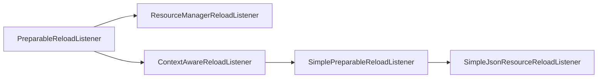

# 重载监听器

有些情况下，Minecraft 或 NeoForge 的现有资源系统无法满足需求，更适合让自己的系统从资源包或数据包加载文件。为此可以注册自定义重载监听器，实现 `PreparableReloadListener` 或其子接口/子类。

重载监听器在资源包或数据包重载时读取新资源；内容会保留到下一次重载，之后丢弃并重新加载。创建时应先确定两件事：

1. 监听器运行在哪个上下文/[端][sides]：决定注册事件和实例保存位置，见[添加和获取监听器][adding]。
2. 监听器加载什么数据：决定基类和需重写的方法，见[监听器类层级][hierarchy]。

:::tip
在服务端，许多场景更适合使用[数据包注册表][datapackregistries]或[数据映射][datamaps]。
:::

## 重载 {#reloading}

资源包和数据包重载原理相似，区别在于物理/逻辑端、时机和加载目录。

| | 客户端监听器 | 服务端监听器|
|---|---|---|
| 加载来源 | 资源包（`assets`） | 数据包（`data`）|
| 首次重载（物理客户端） | 启动 | 创建新世界、进入现有世界、加入服务器|
| 后续重载（物理客户端） | 更改资源包、下载服务器资源包、F3+T | `/reload`|
| 首次重载（物理服务端） | 从不 | 启动|
| 后续重载（物理服务端） | 从不 | `/reload`|

物理客户端离开世界后，已保存的数据会失效，**可能造成内存泄漏**。服务端监听器应按[后文机制][serverlisteners]处理。

:::info
`/reload` 也会重载标签等其他数据包系统，这是设计行为，无法绕过。
:::

### 多线程重载

一次重载通常分为两个阶段：

- **准备**：收集、验证并解析文件，在称为**任务执行器**的多个线程上运行。
- **应用**：把准备结果写入字段或集合，在称为**重载执行器**的主线程上运行。

准备完成后，底层 `CompletableFuture` 会等待 `PreparationBarrier`，所有准备线程结束后才允许应用阶段：

```java
@Override
public CompletableFuture<Void> reload(
    SharedState currentReload,
    Executor taskExecutor,
    PreparationBarrier barrier,
    Executor reloadExecutor
) {
    return CompletableFuture
        // 在此收集并返回准备阶段结果。
        .supplyAsync(() -> {
        }, taskExecutor)
        .thenCompose(barrier::wait)
        // 在此运行应用阶段。
        .thenAcceptAsync(preparations -> {
        }, reloadExecutor);
}
```

## 添加和获取监听器 {#adding-and-retrieving-reload-listeners}

监听器都先创建类，再注册到对应端的事件，最后从对应端获取并操作。

### 客户端监听器

客户端监听器只在启动时收集一次，因此适合使用单例：

```java
public class MyClientReloadListener implements PreparableReloadListener {
    public static final Identifier ID =
            Identifier.fromNamespaceAndPath("mymod", "my_client_reload_listener");
    public static final MyClientReloadListener INSTANCE = new MyClientReloadListener();

    private MyClientReloadListener() {
    }

    // 稍后添加其他方法
}
```

通过 `AddClientReloadListenersEvent` 注册：

```java
@SubscribeEvent // 仅在物理客户端的游戏事件总线上
public static void addClientReloadListeners(AddClientReloadListenersEvent event) {
    event.addListener(MyClientReloadListener.ID, MyClientReloadListener.INSTANCE);
}
```

随后直接访问 `MyClientReloadListener.INSTANCE`。

### 服务端监听器 {#server-side-reload-listeners}

服务端监听器分为两种：

- **一次性监听器**：不保存数据，只执行代码，不保留外部可见引用。
- **保留监听器**：需要自行加载并保存数据。

#### 一次性服务端监听器

```java
public class MyDisposableReloadListener implements PreparableReloadListener {
    public static final Identifier ID =
            Identifier.fromNamespaceAndPath("mymod", "my_disposable_reload_listener");
    // 不保存实例，也不需要隐藏构造方法
}
```

通过 `AddServerReloadListenersEvent` 注册：

```java
@SubscribeEvent // 在游戏事件总线上
public static void addServerReloadListeners(AddServerReloadListenersEvent event) {
    event.addListener(MyDisposableReloadListener.ID, new MyDisposableReloadListener());
}
```

#### 保留服务端监听器

服务端监听器每次数据包重载时都会重新收集，直接使用单例可能造成内存泄漏，也可能让客户端代码错误访问服务端监听器。NeoForge 因此引入保留监听器：它们通过 `MinecraftServer` 实例和 `ListenerKey<T>` 获取，而不是通过单例获取。

```java
public class MyRetainedReloadListener implements PreparableReloadListener {
    public static final Identifier ID =
            Identifier.fromNamespaceAndPath("mymod", "my_retained_reload_listener");
    public static final ListenerKey<MyRetainedReloadListener> LISTENER_KEY = ListenerKey.create(ID);
}
```

注册：

```java
@SubscribeEvent // 在游戏事件总线上
public static void addServerReloadListeners(AddServerReloadListenersEvent event) {
    event.addRetainedListener(MyRetainedReloadListener.LISTENER_KEY, new MyRetainedReloadListener());
}
```

从 `ServerLevel` 获取：

```java
MyRetainedReloadListener listener = serverLevel
        .getServer()
        .getServerResources()
        .managers()
        .getListener(MyRetainedReloadListener.LISTENER_KEY);
```

## 监听器类层级 {#reload-listener-class-hierarchy}



_<span class="mermaid-desc-green">绿色</span>元素为接口，<span class="mermaid-desc-yellow">黄色</span>类为 `abstract`。_

### `PreparableReloadListener`

这是层级根接口，也是上述事件接受的类型。`#reload()` 返回 `CompletableFuture<Void>`，接收 `SharedState`、任务执行器、`PreparationBarrier` 和重载执行器。它还定义：

- `prepareSharedState(SharedState)`：默认不作操作，见[共享重载状态][sharedstate]。
- `getName()`：日志名称，默认返回类名。

它可加载任意内容，例如纹理、字体、数据映射等。许多 JSON 系统会改用下面的抽象类。

### `ContextAwareReloadListener`

提供数据加载条件上下文 `#getContext()` 和 `#getRegistryLookup()`。该类由 NeoForge 添加，因为数据加载条件是 NeoForge 系统。

### `SimplePreparableReloadListener`

把准备和应用拆成 `#prepare()` 与 `#apply()`：

```java
public class MyReloadListener extends SimplePreparableReloadListener<MyObject> {
    public static final Identifier ID = Identifier.fromNamespaceAndPath("mymod", "my_listener");
    public static final MyReloadListener INSTANCE = new MyReloadListener();
    private MyReloadListener() {}

    private MyObject myObject;

    @Override
    protected MyObject prepare(ResourceManager manager, ProfilerFiller profiler) {
        // 收集、解析并验证文件。
        return new MyObject();
    }

    @Override
    protected void apply(MyObject preparations, ResourceManager manager, ProfilerFiller profiler) {
        this.myObject = preparations;
    }

    public MyObject getMyObject() {
        return myObject;
    }
}
```

### `SimpleJsonResourceReloadListener`

继承 `SimplePreparableReloadListener<Map<Identifier, T>>`，用 [`Codec`][codec] 加载 JSON。它自动完成准备阶段，按资源包从上到下扫描，并且每个文件名只保留最顶层条目。因此，类似[标签][tags]的合并或跨包读取需要自行扫描文件夹。

```java
public class MyReloadListener extends SimpleJsonResourceReloadListener<MyObject> {
    public static final Identifier ID = Identifier.fromNamespaceAndPath("mymod", "my_listener");
    public static final MyReloadListener INSTANCE = new MyReloadListener();
    private final Map<Identifier, MyObject> values = new HashMap<>();

    private MyReloadListener() {
        // 参数为 codec 和 FileToIdConverter
        super(MyObject.CODEC, FileToIdConverter.json("mymod/my_listener"));
    }

    @Override
    protected void apply(Map<Identifier, MyObject> preparations, ResourceManager resourceManager, ProfilerFiller profiler) {
        values.clear();
        values.putAll(preparations);
    }

    @Nullable
    public MyObject get(Identifier id) {
        return values.get(id);
    }

    public Map<Identifier, MyObject> getAll() {
        return Collections.unmodifiableMap(values);
    }
}
```

使用：`MyReloadListener.INSTANCE.get(Identifier.fromNamespaceAndPath("mymod", "example"))`。

#### `FileToIdConverter`

把文件路径拆为 `assets`/`data`、命名空间、转换器前缀、文件路径和扩展名，再用命名空间与文件路径构造 `Identifier`。

```java
FileToIdConverter converter = new FileToIdConverter("mymod/my_listener", ".json");
// 等价，自动设置 .json 扩展名：
FileToIdConverter converter = FileToIdConverter.json("mymod/my_listener");
```

例如 `assets/mymod/mymod/my_listener/example_1.json` 会转换为 `mymod:example_1`；`assets/othermod/mymod/my_listener/example_3.json` 转换为 `othermod:example_3`。

`FileToIdConverter#registry()` 可接收注册表资源键并自动生成命名空间前缀路径。为避免多个模组冲突，监听器目录应以模组 ID 开头。

### `ResourceManagerReloadListener`

在重载完成后运行一次，`#onResourceManagerReload()` 提供已填充的 `ResourceManager`，适合清理、缓存构建等后处理。

## 共享重载状态 {#shared-reloading-state}

监听器在不同线程运行。需要读取其他监听器结果时，应通过 `prepareSharedState()` 传递共享状态：

```java
public record MyPendingResources(CompletableFuture<Object> future) {}

public class MyReloadListener implements PreparableReloadListener {
    public static final StateKey<MyPendingResources> STATE_KEY = new StateKey<>();

    @Override
    public void prepareSharedState(SharedState sharedState) {
        sharedState.set(STATE_KEY, new MyPendingResources(/* 任意数据 */));
    }

    private Object prepare(ResourceManager resourceManager) {
        return new Object();
    }

    @Override
    public CompletableFuture<Void> reload(SharedState sharedState, Executor taskExecutor, PreparationBarrier barrier, Executor reloadExecutor) {
        return CompletableFuture.supplyAsync(() -> prepare(sharedState.resourceManager()), taskExecutor)
                .whenComplete((data, error) -> {
                    CompletableFuture<Object> future = sharedState.get(STATE_KEY).future();
                    if (data != null) {
                        future.complete(data);
                    } else {
                        future.completeExceptionally(error);
                    }
                })
                .thenCompose(barrier::wait)
                .thenAcceptAsync(preparations -> {
                    // 应用阶段
                }, reloadExecutor);
    }
}
```

依赖监听器可等待该 future：

```java
public class MyDependentReloadListener implements PreparableReloadListener {
    @Override
    public CompletableFuture<Void> reload(SharedState sharedState, Executor taskExecutor, PreparationBarrier preparationBarrier, Executor reloadExecutor) {
        return sharedState.get(MyReloadListener.STATE_KEY)
                .future()
                .thenApplyAsync(this::prepare, taskExecutor)
                .thenCompose(preparationBarrier::wait)
                .thenAcceptAsync(this::apply, reloadExecutor);
    }

    private Object prepare(Object data) {
        return data;
    }

    private void apply(Object data) {
    }
}
```

[adding]: #adding-and-retrieving-reload-listeners
[clientlisteners]: #client-side-reload-listeners
[codec]: ../datastorage/codecs.md
[conditions]: server/conditions.md
[datamaps]: server/datamaps/index.md
[datapackregistries]: ../concepts/registries.md#datapack-registries
[events]: ../concepts/events.md
[hierarchy]: #reload-listener-class-hierarchy
[identifier]: ../misc/identifier.md
[multithreading]: #multi-threaded-reloading
[preparablereloadlistener]: #preparablereloadlistener
[recipes]: server/recipes/index.md
[resourcekey]: ../misc/identifier.md#resourcekeys
[resources]: index.md
[serverlisteners]: #server-side-reload-listeners
[sharedstate]: #shared-reloading-state
[sides]: ../concepts/sides.md
[sounds]: client/sounds.md
[tags]: server/tags.md
[textures]: client/textures.md
