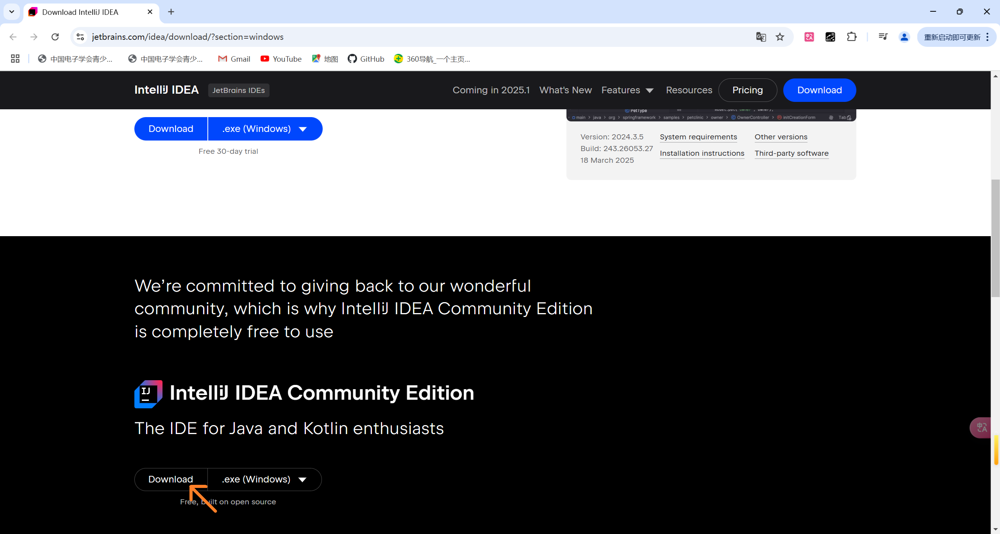
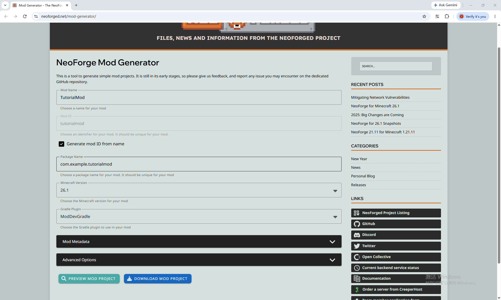
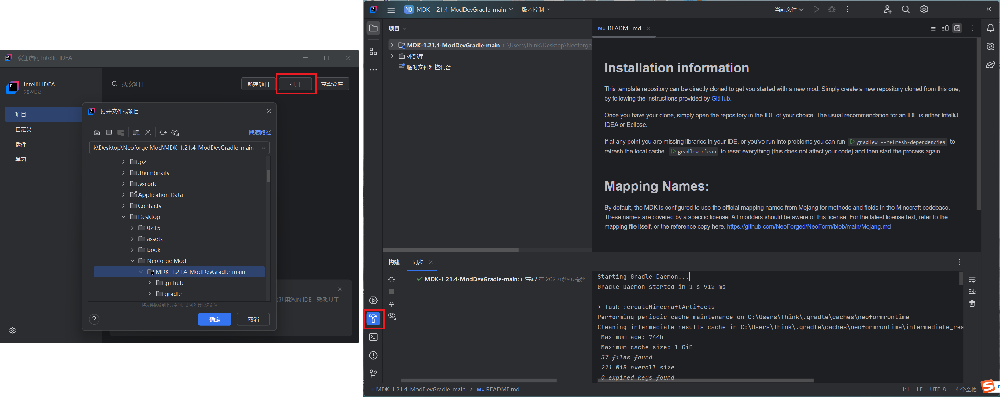
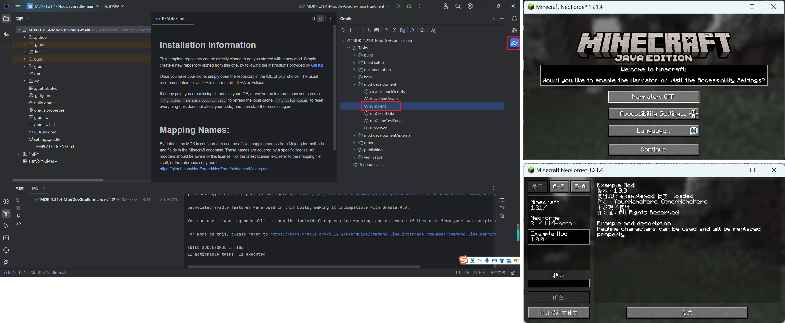

# 环境配置

## 一、安装 JDK 25

从 [Microsoft Build of OpenJDK 下载页](https://learn.microsoft.com/en-us/java/openjdk/download#openjdk-25)安装 64 位 **JDK 25**。
安装完成后，打开 PowerShell，执行：
```powershell
java -version
```
确认输出包含：`25`  `64-Bit`

## 二、安装 IntelliJ IDEA

从 [IntelliJ IDEA 下载页](https://www.jetbrains.com/idea/download/?section=windows)安装 **Community Edition**。

Community Edition 免费，足够完成本教程。



## 三、生成 NeoForge 工程

打开 [NeoForge Mod Generator](https://neoforged.net/mod-generator/)，



填写以下内容：

| 字段 | 示例 | 说明 |
|---|---|---|
| Mod Name | `My First Mod` | 模组列表显示的名称 |
| Mod ID | `myfirstmod` | 模组的内部唯一名称 |
| Package Name | `com.example.myfirstmod` | Java 包名 |
| Minecraft Version | `26.1` | 教程目标版本 |
| Gradle Plugin | `ModDevGradle` | 本教程使用的构建插件 |

下载生成的 ZIP，解压到普通文件夹，例如：

```text
D:\NeoForgeProjects\my-first-mod
```

工程路径尽量使用英文，避免放在压缩包内部。解压后应能看到 `gradlew`、`settings.gradle`、`gradle.properties` 和 `src` 等文件。

## 四、打开并运行工程

在 IDEA 中选择 **Open**，打开解压后的工程文件夹，不要直接打开 ZIP。

IDEA 会自动同步 Gradle 工程。如果要求选择 JDK，请选择 **JDK 25**；也可以在 **Gradle JVM** 或 **Gradle SDK** 设置中指定 JDK 25。

第一次同步会下载 Minecraft、NeoForge 和许多依赖，还可能进行反编译，因此等待十几分钟甚至更久是正常的。同步完成前不要反复关闭工程。



同步完成后，在 IDEA 的 Gradle 面板中找到并运行 `runClient`。
`runClient` 会直接启动当前工程的开发客户端，不需要先打包 JAR，也不需要手动放入 `mods` 文件夹。



进入游戏后：

1. 完成语言等首次启动提示。
2. 打开 **Mods / 模组** 列表。
3. 看到 `My First Mod`。
4. 新建一个测试世界并成功进入。

能看到自己的模组并进入世界，环境配置就完成了。
