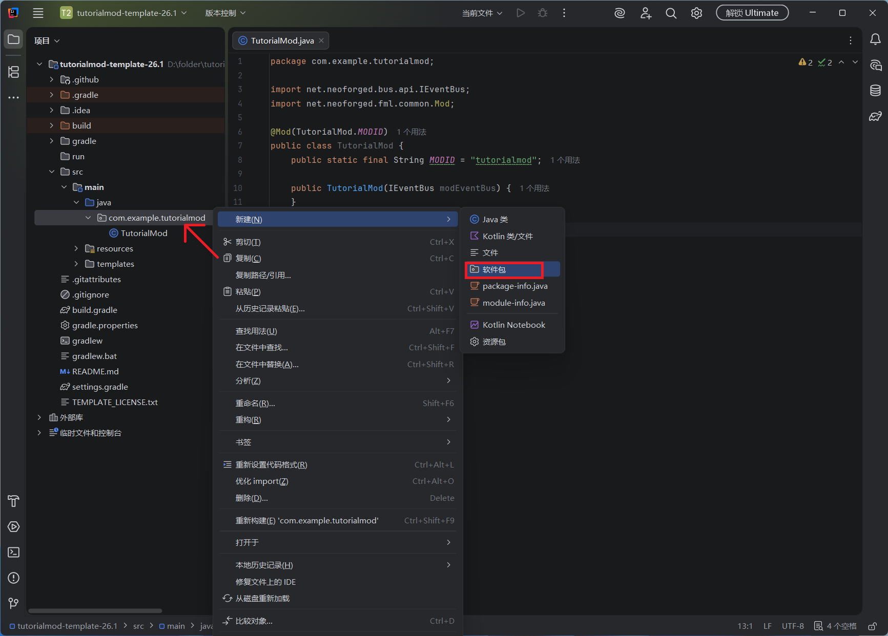
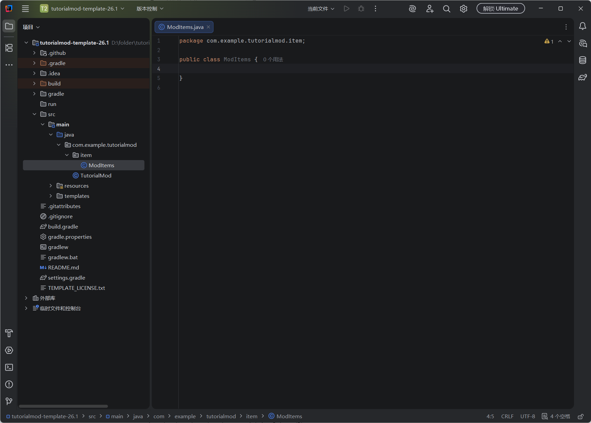
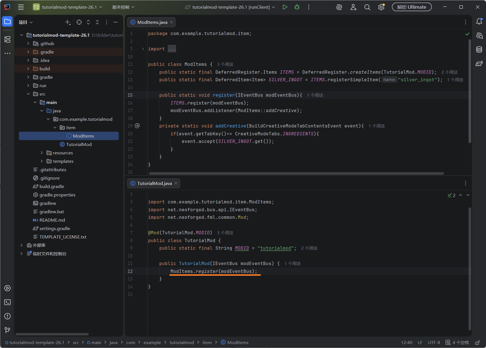
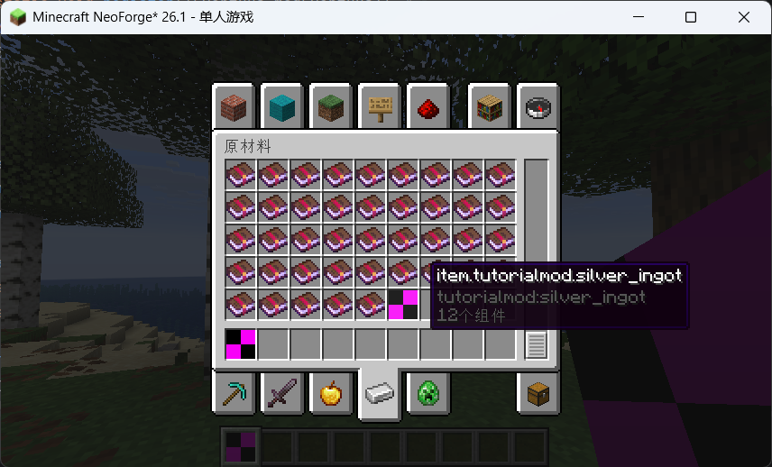
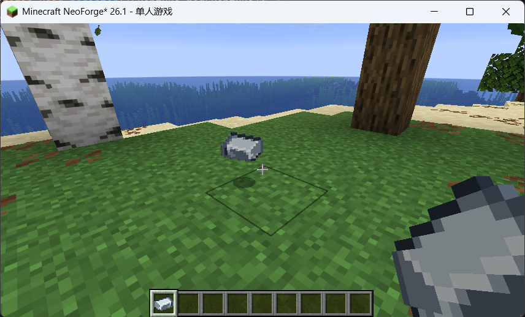

# 制作第一个物品

## 一、整理入口类

入口类位于：

```text
src/main/java/com/example/tutorialmod/TutorialMod.java
```

这些示例代码不影响物品注册，但会增加阅读负担。可以选择删除示例方块、配置、日志事件和客户端演示，只保留入口骨架。下面是删除后的结果：

```java
package com.example.tutorialmod;

import net.neoforged.bus.api.IEventBus;
import net.neoforged.fml.common.Mod;

@Mod(TutorialMod.MODID)
public class TutorialMod {
    public static final String MODID = "tutorialmod";

    public TutorialMod(IEventBus modEventBus) {
    }
}
```

`@Mod` 告诉 NeoForge 这是模组入口，并把入口类与 Mod ID 关联起来。

`IEventBus` 是模组事件总线。它负责模组加载和注册阶段的事件，接收并传给注册方法，后续把物品注册器连接到 NeoForge 的注册流程。

## 二、NeoForge 延迟注册系统

游戏通过注册表认识物品、方块等内容。注册必须发生在游戏规定的阶段，因此 NeoForge 推荐使用 `DeferredRegister`：

- `DeferredRegister` 先记录“准备注册什么”，暂不创建物品。
- 将它连接到模组事件总线后，NeoForge 会在正确的注册阶段创建并登记这些对象。
- `DeferredItem` 是注册句柄；注册完成后调用 `.get()`，才能取得实际物品。

物品使用专门的 `DeferredRegister.Items`。它提供 `registerSimpleItem` 等辅助方法，并自动设置物品 ID。

## 三、创建物品

下面以银锭为例。实际制作时，可以把 `silver_ingot`、`SILVER_INGOT` 和“银锭”分别替换成自己的物品路径、字段名和显示名。

物品 ID 采用“命名空间:路径”的格式。模组自定义物品通常把 Mod ID 用作命名空间。教学工程的 Mod ID 是 `tutorialmod`，示例物品的路径设为 `silver_ingot`：

```text
tutorialmod:silver_ingot
```

物品代码统一放进 `item` 包。

在 `com.example.tutorialmod` 上右键，依次选择“新建”和“软件包”，输入包名 `item`。



接着在 `item` 软件包上右键，新建一个名为 `ModItems` 的 Java 类。



### 1. 创建物品注册器

打开 `ModItems`，在类中加入物品注册器：

```java
public static final DeferredRegister.Items ITEMS =
        DeferredRegister.createItems(TutorialMod.MODID);
```

`DeferredRegister.Items` 是物品专用的延迟注册器，`ITEMS` 用它管理本模组的所有物品。`createItems` 接收命名空间，因此这里传入 `TutorialMod.MODID`。

IDEA 会用红色文字提示缺少导入。把光标放在相关类型上，按 `Alt+Enter` 选择导入即可。

### 2. 添加物品

在注册器下面加入物品字段。下文将使用银锭作为示例；实际制作时，需要将下文所有示例内容替换为你自己的物品内容：

```java
public static final DeferredItem<Item> SILVER_INGOT =
        ITEMS.registerSimpleItem("silver_ingot");
```

`registerSimpleItem` 会创建普通 `Item`，设置 ID `tutorialmod:silver_ingot`，并返回示例物品的 `DeferredItem` 注册句柄。此时还没有取得物品本身。

### 3. 连接注册阶段与入口类

前面声明的 `ITEMS` 和 `SILVER_INGOT` 只是延迟注册句柄，还需要把 `ITEMS` 接到模组事件总线。在 `ModItems` 中加入：

```java
public static void register(IEventBus modEventBus) {
    ITEMS.register(modEventBus);
}
```

`modEventBus` 是 NeoForge 为当前模组创建的事件总线，类型为 `IEventBus`。`ITEMS.register(modEventBus)` 会把物品注册器接到这条总线上；对应的注册事件触发时，`DeferredRegister` 才会创建并登记物品。事件总线的更多说明见[事件总线](/docs/concepts/events/#event-buses)。

打开入口类 `src/main/java/com/example/tutorialmod/TutorialMod.java`，在构造方法中调用：

```java
public TutorialMod(IEventBus modEventBus) {
    ModItems.register(modEventBus);
}
```

NeoForge 加载模组时会调用入口类构造方法，并将 `modEventBus` 传入。没有这次调用，`ModItems.register` 就不会执行，物品注册器也无法接入注册流程。

### 4. 加入创造模式标签页

物品完成注册后，还需要响应“正在构建创造模式标签页”的事件。先在 `register` 方法末尾加入：

```java
modEventBus.addListener(ModItems::addCreative);
```

此时完整的 `register` 方法为：

```java
public static void register(IEventBus modEventBus) {
    ITEMS.register(modEventBus);
    modEventBus.addListener(ModItems::addCreative);
}
```

这一行告诉事件总线：事件发生时调用本类的 `addCreative` 方法。接着在 `register` 方法外加入处理逻辑：

```java
private static void addCreative(BuildCreativeModeTabContentsEvent event) {
    if (event.getTabKey() == CreativeModeTabs.INGREDIENTS) {
        event.accept(SILVER_INGOT.get());
    }
}
```

`getTabKey()` 用于判断当前处理的是哪个标签页，这里只处理原版“原材料”标签页。`event.accept(SILVER_INGOT.get())` 把示例物品加入该标签页。事件触发时物品注册已经完成，因此可以安全调用 `.get()`。

完成后的代码：



可以运行 `runClient` 并进入创造模式世界，打开“原材料”标签页。示例物品已经能被游戏识别，并显示完整 ID `tutorialmod:silver_ingot`。



此时示例物品的名称仍是翻译键，图标也是缺失贴图的紫黑方块。这表示物品注册已经成功，但名称、模型和贴图还没有提供；下一步专门补齐这些资源。

## 四、补上名称、模型和贴图

注册成功只代表游戏认识了这件物品，显示名称和图标仍由资源文件提供。需要在以下位置添加文件：

```text
src/main/resources/assets/tutorialmod/
├─ items/
│  └─ silver_ingot.json
├─ models/
│  └─ item/
│     └─ silver_ingot.json
├─ textures/
│  └─ item/
│     └─ silver_ingot.png
└─ lang/
   ├─ en_us.json
   └─ zh_cn.json
```

### 1. 添加名称

物品的默认翻译键由物品类型、命名空间和注册路径依次用点连接，格式为：

```text
<类型>.<命名空间>.<注册路径>
```

不知道翻译键是什么可以看游戏中翻译前显示的名字。

物品的类型固定为 `item`。银锭的 ID 是 `tutorialmod:silver_ingot`，其中 `tutorialmod` 是命名空间，`silver_ingot` 是注册路径，因此默认翻译键是：

```text
item.tutorialmod.silver_ingot
```

在 `lang/en_us.json` 中加入：

```json
{
  "item.tutorialmod.silver_ingot": "Silver Ingot"
}
```

在 `lang/zh_cn.json` 中加入：

```json
{
  "item.tutorialmod.silver_ingot": "银锭"
}
```

### 2. 添加客户端物品定义

在 26.1 中，物品显示通常分成两个 JSON 文件：

- `items/silver_ingot.json`：决定使用哪个模型。
- `models/item/silver_ingot.json`：描述模型形状并指向贴图。

`items/silver_ingot.json` 的内容为：

```json
{
  "model": {
    "type": "minecraft:model",
    "model": "tutorialmod:item/silver_ingot"
  }
}
```

这个文件是 26.1 物品渲染流程的入口。文件名 `silver_ingot.json` 必须与物品注册名一致。

### 3. 添加物品模型

`models/item/silver_ingot.json` 的内容为：

```json
{
  "parent": "minecraft:item/generated",
  "textures": {
    "layer0": "tutorialmod:item/silver_ingot"
  }
}
```

`minecraft:item/generated` 是原版提供的平面物品模型，适合宝石、材料等普通图标。

### 4. 添加贴图

制作一张16*16像素物品的材质图片并放在下面路径：

```text
src/main/resources/assets/tutorialmod/textures/item/silver_ingot.png
```

图标周围保持透明，文件是 PNG。模型里的 `tutorialmod:item/silver_ingot` 会自动对应到 `textures/item/silver_ingot.png`。

暂时没有贴图时，可以把模型中的 `layer0` 改成原版纸的贴图来验证流程：

```json
"layer0": "minecraft:item/paper"
```

资源准备完成后，物品栏图标、手持模型和掉落物的显示结果如下：



`items/silver_ingot.json` 选择物品模型，`models/item/silver_ingot.json` 描述模型并指向贴图。物品栏、手持和掉落物会复用同一个模型，只根据显示位置套用不同的旋转、缩放和位移。因此通常不需要为掉落物单独制作模型。

### 可选：修改物品属性

`registerSimpleItem` 的第二个参数可以修改物品属性。例如：

- `props -> props.stacksTo(16)`：将最大堆叠数从默认的 64 改为 16。
- `props -> props.fireResistant()`：让该物品掉落后形成的物品实体免疫火焰和熔岩。

需要同时使用这两项时，可以使用链式调用：

```java
public static final DeferredItem<Item> SILVER_INGOT =
        ITEMS.registerSimpleItem("silver_ingot",
                props -> props.stacksTo(16).fireResistant());
```

更多可设置的属性见[文档](/docs/items/#创建物品)。
