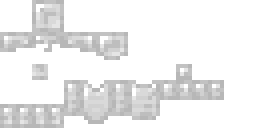

# 工具、盔甲与消耗品

下面以银制工具、四件银制盔甲和可食用的银锭为例。实际制作时，把 `silver_pickaxe`、`silver_helmet`、`SILVER_PICKAXE`、`SILVER_HELMET` 等注册 ID、字段名和显示名称换成自己的内容即可。

## 一、物品定义与物品堆

同一件工具或盔甲在游戏中会同时出现“注册类型”和“具体物品堆”两个层次：

| 对象 | 含义 |
| --- | --- |
| `Item` | 注册表中的物品类型，保存这类物品共同拥有的一组默认数据组件 |
| `ItemStack` | 物品栏或世界中的具体物品堆，包含数量以及当前数据组件 |
| `DataComponentType<T>` | 数据组件的类型键，决定组件值的 Java 类型和读写方式 |
| 数据组件值 | 附着在物品类型或物品堆上的实际数据，例如耐久、食物或装备槽 |

物品栏里的一把银镐是一个 `ItemStack`，其中的物品类型是注册后的 `SILVER_PICKAXE`。这把银镐已经损失 10 点耐久，只会改变这个 `ItemStack` 的 `DAMAGE` 组件；新创建的银镐仍使用物品类型上的默认值。

```java
ItemStack damagedPickaxe = new ItemStack(ModItems.SILVER_PICKAXE.get());
damagedPickaxe.set(DataComponents.DAMAGE, 10);
```

26.1 不再为这些行为提供 `PickaxeItem`、`ArmorItem`、`FoodItem` 等通用物品子类。工具、盔甲和食物通常注册为普通 `Item`，通过 `Item.Properties` 安装 `TOOL`、`EQUIPPABLE`、`CONSUMABLE` 等默认组件，再由原版系统读取这些组件执行对应行为。

## 二、定义工具材料

在 `ModItems` 中加入银制工具材料。工具材料保存耐久、挖掘速度、攻击加成、附魔能力和修理材料，不直接代表某一把具体工具。

先声明修理物品标签：

```java
public static final TagKey<Item> SILVER_REPAIR_ITEMS =
        ItemTags.create(Identifier.fromNamespaceAndPath(
                TutorialMod.MODID, "silver_repair_items"));
```

标签此时只有类型和 ID，具体包含哪些物品仍由数据包 JSON 决定。接着声明工具材料：

```java
public static final ToolMaterial SILVER_TOOL_MATERIAL = new ToolMaterial(
        BlockTags.INCORRECT_FOR_IRON_TOOL, // 不能产生掉落的方块
        400,                               // 耐久
        7.0F,                              // 挖掘速度
        2.0F,                              // 攻击伤害加成
        18,                                // 附魔能力
        SILVER_REPAIR_ITEMS                // 铁砧修理材料
);
```

这里复用 `minecraft:incorrect_for_iron_tool`，表示银制工具拥有与铁制工具相同的方块等级上限，但耐久和挖掘速度更高。若材料需要独立等级，应创建自己的 `incorrect_for_<材料>_tool` 方块标签，并把高于该等级的原版需求标签加入其中。建立新等级时，还要同步维护哪些方块需要该等级工具的标签，否则方块、工具和战利品会使用不同的等级判断。

## 三、注册工具

不同工具类型由对应的属性方法设置。以下参数依次表示工具材料、攻击伤害基线和攻击速度修正：

```java
props.pickaxe(toolMaterial, attackDamageBaseline, attackSpeedBaseline); //镐
props.axe(toolMaterial, attackDamageBaseline, attackSpeedBaseline); //斧
props.shovel(toolMaterial, attackDamageBaseline, attackSpeedBaseline); //锹
props.hoe(toolMaterial, attackDamageBaseline, attackSpeedBaseline); //锄
props.sword(toolMaterial, attackDamageBaseline, attackSpeedBaseline); //剑
```

这三个参数分别控制：

- `toolMaterial`：材料的基础耐久、挖掘速度、攻击伤害加成、附魔能力和修理物品标签，并决定这套材料不能使其掉落的方块等级。
- `attackDamageBaseline`：工具自身的攻击伤害基线。最终攻击属性会在此基础上计入材料的攻击伤害加成，并受到实体基础攻击属性的影响。
- `attackSpeedBaseline`：叠加到实体基础攻击速度上的修正，决定连续攻击的间隔。它不是直接填写的“每秒攻击次数”，使用负数会降低攻击速度。

在 `ModItems` 中以银镐为例加入工具：

```java
public static final DeferredItem<Item> SILVER_PICKAXE =
        ITEMS.registerSimpleItem(
                "silver_pickaxe",
                props -> props.pickaxe(SILVER_TOOL_MATERIAL, 1.0F, -2.8F)
        );
```

`pickaxe` 会同时设置：

- 镐对应的挖掘速度规则和方块掉落规则。
- `MAX_DAMAGE`、初始 `DAMAGE` 组件，以及最大堆叠数 1。
- 攻击伤害、攻击速度和攻击时消耗耐久等属性。
- 铁砧修理与附魔能力。

这些属性方法设置的是工具材料、挖掘规则和攻击属性。斧、锹、锄还需要对应的 `AxeItem`、`ShovelItem`、`HoeItem` 子类处理右键修改方块；直接注册这些子类时，它们会在自己的构造方法中调用对应属性方法。

把银镐加入创造模式标签页的方法与第 2 篇相同，在 `addCreative` 中把它加入 `CreativeModeTabs.TOOLS_AND_UTILITIES` 对应的分支。

## 四、设置工具外观与原版分类

银镐需要以下客户端资源：

```text
assets/tutorialmod/
├─ items/silver_pickaxe.json
├─ models/item/silver_pickaxe.json
└─ textures/item/silver_pickaxe.png
```

`items/silver_pickaxe.json` 的写法与第 2 篇的普通物品相同，只需把模型改成 `tutorialmod:item/silver_pickaxe`。物品模型使用手持模型：

```json
{
  "parent": "minecraft:item/handheld",
  "textures": {
    "layer0": "tutorialmod:item/silver_pickaxe"
  }
}
```

`minecraft:item/handheld` 会按照工具在手中的方向旋转物品。贴图仍是一张透明的 16×16 PNG，放在 `textures/item/silver_pickaxe.png`。

工具需要进入原版物品分类，才能参与相应的附魔和游戏规则。在 `data/minecraft/tags/item/pickaxes.json` 中加入：

```json
{
  "values": [
    "tutorialmod:silver_pickaxe"
  ]
}
```

这个文件扩充的是原版 `minecraft:pickaxes` 标签，因此路径位于 `minecraft` 命名空间，标签里的物品 ID 仍使用 `tutorialmod`。加入后，银镐会被矿工附魔等原版规则识别为镐。

工具材料引用的修理标签需要自己的文件 `data/tutorialmod/tags/item/silver_repair_items.json`：

```json
{
  "values": [
    "tutorialmod:silver_ingot"
  ]
}
```

按第 5 篇的语言提供器为银镐添加名称：英文使用 `Silver Pickaxe`，中文使用 `银镐`。

## 五、定义盔甲材料

盔甲材料除了防护数值，还要指向一个客户端装备外观资源。先在 `ModItems` 中声明资源键：

```java
private static final ResourceKey<EquipmentAsset> SILVER_EQUIPMENT_ASSET =
        ResourceKey.create(
                EquipmentAssets.ROOT_ID,
                Identifier.fromNamespaceAndPath(TutorialMod.MODID, "silver")
        );
```

这个键指向 `assets/tutorialmod/equipment/silver.json`。它只负责找到外观定义，不直接保存贴图。

继续声明盔甲材料：

```java
public static final ArmorMaterial SILVER_ARMOR_MATERIAL = new ArmorMaterial(
        15, // 耐久倍率
        Map.of(
                ArmorType.HELMET, 2,
                ArmorType.CHESTPLATE, 6,
                ArmorType.LEGGINGS, 5,
                ArmorType.BOOTS, 2,
                ArmorType.BODY, 4
        ),
        18,                                  // 附魔能力
        SoundEvents.ARMOR_EQUIP_IRON,        // 穿戴声音
        0.5F,                                // 盔甲韧性
        0.0F,                                // 击退抗性
        SILVER_REPAIR_ITEMS,                 // 铁砧修理材料
        SILVER_EQUIPMENT_ASSET               // 客户端装备外观
);
```

耐久倍率会乘上部位自身的单位耐久，例如头盔为 11，因此银头盔的耐久为 `15 × 11 = 165`。`defense` 按部位分别保存防护值。如果准备用这个材料制作整套盔甲，应把所有部位放入映射；以后新增其他部位时可以直接复用同一材料。

## 六、注册盔甲

`humanoidArmor` 接收盔甲材料和盔甲部位：

```java
props.humanoidArmor(armorMaterial, armorType);
```

第一个参数提供耐久倍率、各部位防护值、附魔能力和修理材料。第二个参数决定装备槽，并选择该部位对应的单位耐久和防护值。同一个方法适用于头盔、胸甲、护腿和靴子四个类人盔甲部位。

四个部位分别使用以下参数：

| `ArmorType` | 注册路径 | 示例字段名 |
| --- | --- | --- |
| `ArmorType.HELMET` | `silver_helmet` | `SILVER_HELMET` |
| `ArmorType.CHESTPLATE` | `silver_chestplate` | `SILVER_CHESTPLATE` |
| `ArmorType.LEGGINGS` | `silver_leggings` | `SILVER_LEGGINGS` |
| `ArmorType.BOOTS` | `silver_boots` | `SILVER_BOOTS` |

在 `ModItems` 中以银头盔为例注册盔甲：

```java
public static final DeferredItem<Item> SILVER_HELMET =
        ITEMS.registerSimpleItem(
                "silver_helmet",
                props -> props.humanoidArmor(
                        SILVER_ARMOR_MATERIAL,
                        ArmorType.HELMET
                )
        );
```

`humanoidArmor` 会根据 `ArmorType.HELMET` 设置头部装备槽、头盔耐久、防护属性、附魔能力、修理材料和外貌资源键。装备槽来自 `EQUIPPABLE` 组件，防护数值来自 `ATTRIBUTE_MODIFIERS` 组件，二者不是普通物品的硬编码字段。

其余三件盔甲按相同结构注册，只替换表格中的注册路径、字段名和 `ArmorType`。最后把四件盔甲都加入 `CreativeModeTabs.COMBAT` 对应的创造模式标签页，方法与第 2 篇相同。

## 七、设置全套盔甲外观

完整的穿戴外观需要两张 64×32 的装备层贴图：

```text
assets/tutorialmod/
├─ equipment/
│  └─ silver.json
└─ textures/entity/equipment/
   ├─ humanoid/silver.png
   └─ humanoid_leggings/silver.png
```

四件物品的 `items` 定义、`models/item` 模型和 16×16 `textures/item` 图标按第 2 篇添加，路径分别使用 `silver_helmet`、`silver_chestplate`、`silver_leggings` 和 `silver_boots`；物品图标与穿戴贴图是两套资源。

`equipment/silver.json` 把装备外观资源键连接到两套穿戴图层：

```json
{
  "layers": {
    "humanoid": [
      {
        "texture": "tutorialmod:silver"
      }
    ],
    "humanoid_leggings": [
      {
        "texture": "tutorialmod:silver"
      }
    ]
  }
}
```

`humanoid` 层中的 `tutorialmod:silver` 会解析为 `assets/tutorialmod/textures/entity/equipment/humanoid/silver.png`，用于头盔、胸甲和靴子。`humanoid_leggings` 层中的同名标识会解析为 `assets/tutorialmod/textures/entity/equipment/humanoid_leggings/silver.png`，用于护腿。

头盔、胸甲和靴子共用这一张 64×32 的 `humanoid` 贴图，但它们在图内使用各自固定的 UV 区域，并不会读取完全相同的像素。原版铁盔甲的这一层贴图如下：



护腿使用另一张 64×32 的 `humanoid_leggings` 贴图：


完整的四件套必须同时提供这两层和两张贴图。 |

最后，按部位把四件盔甲加入原版物品标签。以头盔为例，在 `data/minecraft/tags/item/head_armor.json` 中加入：

```json
{
  "values": [
    "tutorialmod:silver_helmet"
  ]
}
```

其余三个部位按相同格式分别加入对应标签：

| 标签文件 | 加入的物品 |
| --- | --- |
| `data/minecraft/tags/item/chest_armor.json` | `tutorialmod:silver_chestplate` |
| `data/minecraft/tags/item/leg_armor.json` | `tutorialmod:silver_leggings` |
| `data/minecraft/tags/item/foot_armor.json` | `tutorialmod:silver_boots` |

这些标签让原版按部位识别四件盔甲，影响护甲附魔、盔甲纹饰等规则。

## 八、消耗品组件

以可食用的银锭为例。修改第 2 篇的银锭注册，为它安装 `FOOD` 和 `CONSUMABLE` 两个组件：

```java
public static final DeferredItem<Item> SILVER_INGOT =
        ITEMS.registerSimpleItem(
                "silver_ingot",
                props -> props.food(
                        new FoodProperties.Builder()
                                .nutrition(6)
                                .saturationModifier(0.8F)
                                .alwaysEdible()
                                .build(),
                        Consumable.builder()
                                .consumeSeconds(1.2F)
                                .onConsume(new ApplyStatusEffectsConsumeEffect(
                                        new MobEffectInstance(
                                                MobEffects.SPEED, 160, 0
                                        )
                                ))
                                .build()
                )
        );
```

食物和消耗品承担不同职责：

| 组件 | 作用 |
| --- | --- |
| `FOOD` | 定义营养值、饱食度修饰，以及饥饿值已满时能否继续食用 |
| `CONSUMABLE` | 定义使用时间、动画、声音、粒子，以及使用完成后执行的效果 |

`nutrition(6)` 设置食物营养值，`saturationModifier(0.8F)` 决定由营养值换算出的饱食度。`alwaysEdible()` 允许玩家在饥饿值已满时继续食用。`consumeSeconds(1.2F)` 是使用时间，内部会换算为 24 tick；效果持续时间使用 tick，`160` tick 等于 8 秒。

`onConsume` 接收一个 `ConsumeEffect`。这里选择为食用者添加 8 秒速度 I；第三个参数 `0` 是效果等级偏移，因此表示 I 级。需要一次添加多个效果时，可以传入效果列表，或继续调用 `onConsume` 添加其他效果。

不设置自定义使用时间时，也可以只调用 `props.food(foodProperties)`。此时会使用原版默认食物消耗方式，持续约 1.6 秒。饮用型物品则可把消耗动画改为 `ItemUseAnimation.DRINK`，并换成相应的饮用声音。

更多组件和可选参数见[数据组件](/docs/items/datacomponents/)、[工具](/docs/items/tools/)、[盔甲](/docs/items/armor/)和[消耗品](/docs/items/consumables/)。
